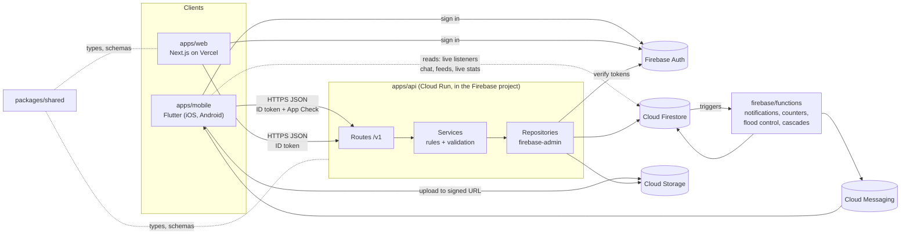
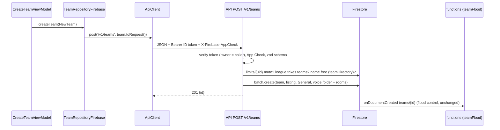

# Stall 10 architecture

The target architecture for Stall 10 as a monorepo, the phases that get us
there, and where the migration stands. For how every feature works *today*
(screens, Firestore layout, rules, Cloud Functions), see
[docs/ARCHITECTURE.md](docs/ARCHITECTURE.md).

**Contents**
1. [Goals](#1-goals)
2. [Repository layout](#2-repository-layout)
3. [System overview](#3-system-overview)
4. [Responsibilities](#4-responsibilities)
5. [The API](#5-the-api)
6. [Data: Firestore and Cloud Storage](#6-data-firestore-and-cloud-storage)
7. [Caching](#7-caching)
8. [Build, hosting and environments](#8-build-hosting-and-environments)
9. [Phases](#9-phases)
10. [Migration status and checklist](#10-migration-status-and-checklist)
11. [Open decisions](#11-open-decisions)
12. [Known issues](#12-known-issues)

---

## 1. Goals

- **One backend that clients talk to.** The Flutter app and the website
  call a Node.js API, which validates every request, applies the business
  rules and reads and writes Firebase. Clients stop writing Firestore and
  Storage directly.
- **Firebase stays the platform.** Firebase Auth signs people in, Cloud
  Firestore holds app data (users, teams, organizations, leagues, posts…),
  and Cloud Storage holds images and video. The API decides who may do
  what with them; the security rules become a backstop.
- **Flutter for phones only.** `apps/mobile` targets iOS (first) and
  Android. The website moves to Next.js (`apps/web`) in phase 3.
- **Shared contracts.** Request and response types, validation schemas and
  pure logic used by more than one TypeScript app live in `packages/`.

## 2. Repository layout

```
Stall10/                          (this repo)
├── apps/
│   ├── mobile/                   Flutter app: iOS + Android (Dart package `frisbee_app`)
│   │   ├── lib/                  MVVM: data/services → data/repositories → ui/<feature>/view_models → widgets
│   │   ├── test/                 Unit and widget tests (flutter test)
│   │   ├── ios/ android/         Shipping platforms
│   │   └── web/ windows/ macos/  Transitional (see §9): web is today's website, Windows is the dev target
│   ├── api/                      Node.js API (TypeScript, Fastify, firebase-admin, zod)
│   │   ├── src/                  app.ts, server.ts, auth.ts, errors.ts, <feature>/{routes,service,repository}.ts
│   │   └── test/                 Unit tests (fakes) + *.emulator.test.ts (Firestore/Auth emulators)
│   └── web/                      Next.js website (phase 3), on Vercel
├── packages/
│   └── shared/                   @stall10/shared: API types, zod schemas, shared pure logic
│       └── fixtures/             Cross-language test vectors (written by Dart tests, checked by TS tests)
├── firebase/                     Firebase project config
│   ├── firebase.json .firebaserc firestore.rules firestore.indexes.json storage.rules
│   ├── functions/                Cloud Functions (triggers, scheduled jobs, existing callables)
│   ├── hosting/                  Static pages (/about, /privacy, invite fallbacks)
│   ├── scripts/                  build_site.sh (today's website), monitoring/
│   └── docs/                     app-check, cloud-limits, monitoring, rollback
├── docs/                         Current-state architecture, user guide, changelog, iOS release
├── .github/workflows/            Backend deploy/rollback, Node CI
├── codemagic.yaml                iOS builds (TestFlight / App Store) from apps/mobile
├── package.json pnpm-workspace.yaml tsconfig.base.json
└── ARCHITECTURE.md               This file
```

Tooling: **pnpm workspaces** for `apps/api`, `apps/web` and `packages/*`.
`apps/mobile` is a pub (Flutter) project. `firebase/functions` stays a
standalone npm project because `firebase deploy` uploads only that folder,
so it can't depend on workspace packages.

## 3. System overview



A write, end to end (create a team, the first migrated operation):



## 4. Responsibilities

| Part | Owns | Doesn't |
|---|---|---|
| **apps/mobile** | UI, view models, local state and caches, Firebase Auth sign-in, App Check, push registration | Business rules or validation that matters for security; direct Firestore/Storage writes (being removed feature by feature) |
| **apps/web** | Public pages (SEO), signed-out browsing, member web app (phase 3); server-rendered reads through the API's `/v1/public/*`; member reads from Firestore in the browser, as the app does (rules guard them), with listeners for live data | Writes outside the API |
| **apps/api** | Authentication of every request (ID token), App Check, validation (zod), authorization (team roles and permissions), business logic, all Firestore and Storage access for clients, media upload URLs and compression, response caching | Long-running or event-driven work (that stays in functions) |
| **packages/shared** | Wire types, zod schemas, error codes, pure logic shared by API and web (keywords, team-name rules) | Anything with I/O |
| **firebase/** | Rules, indexes, Cloud Functions triggers and schedules, hosting of static pages | Client-facing request handling (new endpoints go in the API, not new callables) |
| **Firebase** | Auth, Firestore, Storage, Cloud Messaging, App Check | — |

## 5. The API

**Stack:** Node.js 22, TypeScript (ESM), Fastify 5, firebase-admin, zod.

**Layers** (mirroring the app's MVVM split):
- `routes.ts`: HTTP only. Reads the caller, hands the body to a service,
  shapes the response.
- `service.ts`: the rules. Validates with the shared zod schema, checks
  permissions, runs business logic. Has no Firebase imports, so unit tests
  run it against fakes.
- `repository.ts`: an interface plus a Firestore implementation; the only
  code that touches the database.

**Conventions**
- Versioned paths: `/v1/<resource>`. JSON in and out; body limit 64 KB
  (media never passes through as JSON).
- Auth: `Authorization: Bearer <Firebase ID token>`, verified with the Admin
  SDK. The acting user always comes from the token, never the body.
- App Check: `X-Firebase-AppCheck`, verified when present; required when
  `ENFORCE_APP_CHECK=true` (same switch as the callables, `firebase/docs/app-check.md`).
- Errors: every non-2xx is `{ "error": { "code", "message", "fields"? } }`
  with codes from `packages/shared/src/api.ts`. `message` is written for
  people; the app shows it as is.
- **The Admin SDK bypasses `firestore.rules`.** Each migrated operation
  must re-implement everything its rule checked (shape, limits, ownership,
  mutes, references) in the service, with tests. Flood-control triggers in
  `firebase/functions` keep working because they fire on the documents,
  whoever writes them.
- Parity: when the app and the API both write the same documents during a
  migration, a Dart test writes the expected documents to
  `packages/shared/fixtures/*.json` and the API's tests check its output
  against the same file (`apps/mobile/test/data/shared_fixtures_test.dart`).
- Credentials: Application Default Credentials only (Cloud Run's service
  identity; `gcloud auth application-default login` or the emulators
  locally). No service-account key files anywhere.

**Endpoints** (all need an ID token; answers are `{}` unless noted)
- Teams: `POST /v1/teams` → `{id}`; `PATCH /v1/teams/:id` (details +
  listing); `PUT /v1/teams/:id/listing`; `POST /v1/invite-codes` →
  `{code, teamId, expiresAt}`.
- Joining: `POST /v1/teams/join` `{code}` → `{teamId}`;
  `POST /v1/teams/:id/members` (open group); `POST|DELETE
  /v1/teams/:id/join-requests[/:uid]`; `POST
  /v1/teams/:id/join-requests/:uid/approve`; `POST /v1/teams/:id/invites`
  (the team's member managers, or its community's for a team it links);
  `POST /v1/me/team-invites/:teamId/accept`; `DELETE
  /v1/me/team-invites/:teamId`.
- Members: `DELETE /v1/teams/:id/members/:uid` (leave/remove); `PUT
  /v1/teams/:id/members/:uid/role`; `PUT .../stat-keeper`; `POST
  /v1/teams/:id/owner`; `PUT /v1/teams/:id/roles`.
- Roster: `GET /v1/teams/:id/roster` → `TeamRoster` (any signed-in
  caller; a private group's only to its members), with a community's
  linked teams in `teams`.
- Communities: `PUT|DELETE /v1/teams/:id/community`; `POST
  /v1/teams/:org/link-requests/:team/accept`; `DELETE
  /v1/teams/:org/link-requests/:team`; `PUT|DELETE
  /v1/teams/:org/linked-teams/:team`; `POST /v1/teams/:org/linked-teams` →
  `{id}`.
- Media: `POST /v1/uploads` → `{id, uploadUrl, headers, expiresAt}`;
  `POST /v1/uploads/:id/complete` → `{id, status, path?, thumbPath?, …}`.
- Profile: `POST /v1/me/username` → `{username}`; `PUT
  /v1/me/profile/details`; `PUT /v1/me/profile/privacy`; `PUT
  /v1/me/profile/visibility`.
- Dashboard: `GET /v1/me/home[?before=]` → `MeHome` (own profile with
  `needsUsername`, teams with the caller's role, upcoming events they may
  see per `sees(e)`, and a paged feed of their posts and the people they
  follow). The website's signed-in home page.
- Posts: `PUT|DELETE /v1/posts/:id/like` → `{liked, likeCount}`;
  `PUT|DELETE /v1/posts/:id/repost` (`{note?}`) → `{reposted,
  repostCount}`; `GET /v1/posts/state?ids=a,b` → the caller's likes and
  reposts by id (≤ 50). A repost's likes and reposts go to its original.
  `GET /v1/feed?before=` → the community feed, paged, for members.
- Public (no token; the website server): `GET /v1/public/feed`,
  `/players/:uid`, `/posts/:id`, `/teams/:id`, `/events`, `/search`.
  Visitors get one page (`next: null`); paging is for members.
- `GET /health` → `{ok, version}`; every response carries
  `x-stall10-api-version`.

**Versions:** each app has its own version, bumped with every change and
logged in its changelog. `pnpm test` runs `scripts/check-versions.mjs`,
which fails when the current version has no entry.

| Part | Version in | Changelog |
|---|---|---|
| apps/api | `apps/api/package.json` | `apps/api/CHANGELOG.md` |
| apps/web | `apps/web/package.json` (footer) | `apps/web/CHANGELOG.md` |
| apps/mobile | `apps/mobile/pubspec.yaml` | `docs/CHANGELOG.md` |

**Tests:** `pnpm test` (fakes, fast) and `pnpm test:api:emulator`
(Firestore and Auth emulators, real ID tokens).

## 6. Data: Firestore and Cloud Storage

- **Firestore** holds everything that isn't a media file: users and
  profiles, teams and organizations (`teams/*`, organizations are
  `kind: organization`), leagues and tournaments, posts, comments,
  follows, events, chat. The data model stays as documented in
  `docs/ARCHITECTURE.md`; the API writes the same shapes the app wrote, so
  migrated and unmigrated code can run side by side.
- **Reads and writes** (decided 2026-11-11): every write is validated by
  and goes through the API. Reads come from a cache (§7) or Firebase:
  chat, feed updates and live stats stay as Firestore listeners straight
  from the app, guarded by the read rules.
- **Cloud Storage** holds images and video, always compressed to one
  standard before they're saved (decided 2026-11-11; spec in
  `packages/shared/src/media.ts`):

  | | Accepted uploads | Saved as |
  |---|---|---|
  | Images | Every native photo type on the supported devices: JPEG, PNG, HEIC/HEIF (iPhone, newer Android, macOS), WebP (Android, web), GIF | JPEG, quality 80, longest edge ≤ 1920 px, upright, metadata (GPS) stripped; an image with transparency is saved as PNG. A GIF keeps its first frame. Plus a 480 px JPEG thumbnail. |
  | Video | Every native video type: MP4, MOV (iPhone, macOS), M4V, MKV, WebM (Android, browsers), 3GP (older Android) | MP4: H.264 High + AAC 128 kbps, ≤ 1080p, ≤ 30 fps, CRF 23 capped at 5 Mbps, faststart. Plus a 480 px JPEG poster. |

  Rule (2026-11-11): always accept the native file types of the supported
  devices (iOS, Android, and Windows/macOS through the website), and
  always save one standard format so everything plays natively
  everywhere. HEIC needs an HEVC-capable decoder (libheif/ffmpeg; sharp's
  prebuilt binaries can't read it). Upload limits before compression
  match today's `storage.rules`: 10 MB images, 100 MB post/chat video,
  500 MB team film.

  **Where files live** (decided 2026-11-11): the project's Firebase
  Storage bucket, in the folders the app already uses. Documents keep
  referencing a file by its `path` (e.g. a post's `images[].path`), and
  `storage.rules` decides who may read it, so the API, the app and the
  website all reach the same files:

  | Purpose | Folder | Who reads (storage.rules) |
  |---|---|---|
  | `avatar` | `users/{uid}/profile/` | anyone signed in |
  | `post` | `users/{uid}/posts/{postId}/{uploadId}/` | anyone signed in; visitors if the author is public |
  | `teamImage` | `teams/{teamId}/posts/{postId}/{uploadId}/` | members; visitors for public posts of non-private teams |
  | `teamVideo` | `teams/{teamId}/videos/{videoId}/` | members |
  | `chat` | `teams/{t}/chats/{room}/{uid}/{messageId}/`, `conversations/{c}/{uid}/{messageId}/` | the room's readers; the conversation |

  Processed files are named after the upload id: `{id}.jpg` (or `.png`),
  `{id}_thumb.jpg`, `{id}.mp4`, `{id}_poster.jpg` (`mediaFolder` in
  `apps/api/src/media/service.ts`, `mediaFolders` in shared). Visitors'
  pages get Storage REST URLs, which apply the rules; members' pages ask
  Storage for a link when a file isn't public.

  Flow (API built; no client calls it yet):
  1. Client asks the API for an upload (`POST /v1/uploads`: purpose, type,
     size, target, and `itemId`, the post, video or message it belongs to;
     `createUploadRequestSchema`). The API checks permission
     and limits, records `uploads/{id}` (status `pending`), and returns a
     short-lived signed URL to `uploads/raw/{uid}/{id}`.
  2. Client uploads straight to Storage; media never passes through the
     API as JSON.
  3. Client calls `POST /v1/uploads/{id}/complete`. The API checks the
     real type by its bytes (not the extension), then:
     - **images:** compresses in the request (sharp) and saves the final
       object; the answer carries its path.
     - **videos:** queues a transcode (status `processing`) run by a Cloud
       Run job with ffmpeg in the same project; the job saves the MP4 and
       poster and sets status `ready` (or `failed`). The app follows
       `uploads/{id}` with a listener to show progress.
  4. Only the API's service account can write outside `uploads/raw/`
     (storage.rules); raw files are deleted after processing, and a
     lifecycle rule clears abandoned ones after a day.

  Until this is built the app keeps compressing photos on the device
  (`ImageCompressor`) and uploading under `storage.rules`.
- **Rules** stay deployed and keep protecting reads and any write the app
  still makes. After a feature's API-only build is the oldest in use, its
  client write rules are closed (`allow create: if false`), and the rules
  tests updated.

## 7. Caching

In order of preference:
1. **On the device.** Flutter keeps Firestore's offline cache for listener
   reads, `SharedStreams` (one listener per query), and an in-memory cache
   per repository for API reads; images use the platform HTTP cache
   (Storage objects are served with a year-long `Cache-Control`).
2. **HTTP.** API GETs send `Cache-Control` and `ETag` so clients and Vercel's
   edge (for the website's public pages) can reuse answers.
3. **In the API.** A small in-memory LRU per instance for hot, public,
   read-mostly data (team pages, directory search), with short TTLs.
4. **Shared cache** (Memorystore/Redis) only if instance caches stop being
   enough; not planned.

## 8. Build, hosting and environments

| Part | Built by | Runs on | dev | prod |
|---|---|---|---|---|
| apps/mobile (iOS) | Codemagic (`codemagic.yaml`, `working_directory: apps/mobile`) | TestFlight / App Store | `development` → TestFlight | `main` → App Store |
| apps/mobile (Android) | Codemagic (to add) | Play Store | | |
| apps/api | `apps/api/Dockerfile` (target `api`), GitHub Actions (`deploy-api.yml`; rollback `rollback-api.yml`) | **Cloud Run in each Firebase project** (decided 2026-11-11): service `api`, same project and region as Firestore (us-central1 unless Firestore says otherwise), its own service account `api-runtime` (ADC, no keys), scales to zero; config in `apps/api/deploy/service.yaml`, one-time setup in `apps/api/DEPLOY.md`; optionally behind a Firebase Hosting rewrite (`/api/**`) | `frisbee-app-brianrhonea-dev` | `frisbee-app-brianrhonea` |
| Video transcoding | Same Dockerfile, target `media` (adds ffmpeg); to add | Cloud Run job in each Firebase project (`apps/api/DEPLOY.md`) | dev | prod |
| apps/web | Vercel (Root Directory `apps/web`) | Vercel | preview deployments | production |
| firebase/ | GitHub Actions (`deploy-backend.yml`) | Firebase | `--project dev` | `--project prod` |

The app finds the API through `API_BASE_URL` in its secrets file
(`apps/mobile/secrets*.local.json`, Codemagic's `SECRETS_LOCAL_JSON`).
Builds without one keep using Firestore directly, so nothing changes until
the API is deployed and the URL is added. The `use_api_teams` flag in
`meta/flags` turns the API path off again without a new build.

## 9. Phases

| Phase | Scope | Status |
|---|---|---|
| **1. Monorepo** | Move the app to `apps/mobile`, Firebase to `firebase/`; fix CI (Codemagic, GitHub Actions), site build, docs | **Done** (`monorepo` branch) |
| **2. API + iOS** | `apps/api` and `packages/shared`; migrate features from direct Firestore/Storage writes to the API one at a time (§10); media pipeline; deploy the API to Cloud Run; iOS releases on the new path | **Started**: API scaffold, team creation migrated |
| **3. Website** | Build `apps/web` on Next.js against the API; move the domain from Firebase Hosting to Vercel; retire the Flutter web build (`firebase/scripts/build_site.sh`, `apps/mobile/web`, `lib/main_web.dart`, `lib/ui/web`) | **Started**: public site ported (feed, posts, profiles, teams, events, search, About/Help/legal, invite-link fallbacks, sign-in/sign-up); member area in progress, slice by slice (`docs/product-spec.md` §8.1, W1–W8); dev site on Vercel |

**Transitional pieces** (kept on purpose until their phase):
- `lib/main_web.dart`, `lib/ui/web`, `lib/ui/browse`,
  `firebase/scripts/build_site.sh`: the old Flutter website.
  `apps/mobile/web` was removed (2026-11-12), so it can't be built any
  more; Firebase Hosting keeps serving the last deploy until the domain
  moves to Vercel, and hosting deploys are skipped until then.
- `apps/mobile/windows` and `macos` were removed (2026-11-12): run the
  app on an Android emulator or an iOS/Android device.
- Cloud Functions callables (`account`, `api`, `browse`, `meetings`,
  `discord`, `tournaments`): fold into the API over phase 2.

## 10. Migration status and checklist

**Playbook for each operation**
1. Port the rule(s) that guarded the client write into an API service,
   with the shared zod schema in `packages/shared`.
2. If the app and the API write the same documents, add a fixture-backed
   parity test (see §5).
3. Unit tests with fakes; an emulator test for the repository.
4. App: call the API through `ApiClient` from the repository, behind
   `API_BASE_URL` and a `use_api_*` kill switch; keep the direct path as
   the fallback until the API is live everywhere.
5. Deploy the API; ship the app; once old builds age out, remove the
   fallback and close the client write rule (and update rules tests).

| # | Area | Operations | Notes | Status |
|---|---|---|---|---|
| 1 | Teams | create team / group / organization | `POST /v1/teams` | **Migrated** (fallback kept) |
| 2 | Teams | join (code, link, open group, request/approve), invites, leave, remove, roles, permissions, transfer, edit details, community links, create team in community | Rule functions ported in `apps/api/src/teams/access.ts`, run in transactions (`MembershipService`); `use_api_membership` flag. Still direct: `migrateTiersToRoles` (edits chat rooms, item 10), `deleteTeam`, roster | **Migrated** (fallback kept) |
| 3 | Users | profile edit, username claim, privacy settings, delete account (callable today) | `apps/api/src/profiles`; `use_api_profiles` flag. Still direct: `publishSummary`, header photo, `users/{uid}` settings (owner-only, unvalidated); delete account stays a callable | **Migrated** details, privacy, visibility, username (fallback kept) |
| 4 | Media | upload URLs + server-side compression (§6) | `apps/api/src/media`: sniffing, sharp compression, HEIC via ffmpeg (`ffmpegHeicDecoder`), `transcodeJobs/{id}` + `transcode.ts` for the Cloud Run job; needs `STORAGE_BUCKET`. Not yet: the job's entry point and queue, signed URLs verified against real Storage, app callers (posts/chat/avatars still upload directly) | **API built**, app not switched |
| 5 | Posts | posts, team posts, comments, likes, reposts | `apps/api/src/posts`: likes, reposts, text posts (create/edit/delete, photos from `/v1/uploads`), comments (the website uses them; the app still writes directly). Unit tests with fakes; emulator tests pending. Not yet: team posts, creating workout/event posts, video in posts | **Players' posts and comments in the API**, app not switched |
| 6 | Follows | follow, requests, accept | `apps/api/src/follows`, with notification read/clear (the website uses them; the app still writes directly). Unit tests with fakes; emulator tests pending | **In the API**, app not switched |
| 7 | Events | team/personal events, RSVPs, polls | | |
| 8 | Leagues & tournaments | hosted tournaments, leagues, signups, drafts | Some already callables; move them to the API | |
| 9 | Search & browse | `api-search`, `browse-*` callables → API GETs with caching | Website (phase 3) depends on these | |
| 10 | Chat & DMs | send, edit, react; rooms and folders | Writes via the API; reads stay Firestore listeners (§11.2) | |
| 11 | Meetings & voice | LiveKit tokens (callable today) | | |
| — | Stays on device | theme, workout recording, playbook drawing (until saved) | | n/a |

## 11. Decisions

Decided (2026-11-11):

1. **API host:** Cloud Run in each Firebase project (dev and prod), next
   to Firestore with the project's own identity. Video transcoding runs as
   a Cloud Run job in the same project.
2. **Reads and writes:** every write is verified by and goes through the
   API. Reads come from a cache or straight from Firebase; chat, feed
   updates and live stats keep Firestore listeners (no WebSockets from
   the API).
3. **Media:** images and video go to Cloud Storage, compressed to one
   standard before saving. Accepted: every native type on iOS, Android and
   Windows/macOS browsers (JPEG, PNG, HEIC/HEIF, WebP, GIF; MP4, MOV, M4V,
   MKV, WebM, 3GP). Saved as JPEG (PNG if transparent) and MP4/H.264 (§6,
   `packages/shared/src/media.ts`).
4. **Platforms:** Flutter only for iOS and Android. Windows, macOS and
   every other desktop use the Next.js website, which becomes the full
   member app, not only public pages (phase 3, started 2026-11-11).

Still open:

5. **Closing client write rules.** When to drop the fallback and lock each
   rule, given TestFlight/App Store builds still in use.
6. **Generated Dart types.** Hand-written Dart models today; consider
   generating them from the zod schemas (JSON Schema → Dart) once there
   are many endpoints.
7. **Transcode cost.** ffmpeg on Cloud Run (recommended: CPU minutes only)
   vs. the Transcoder API ($0.015/min); revisit if video volume grows.

## 12. Known issues

- **Punctuated team names escape the name check.** Directory keywords
  split on `.`, so "TX B.Q.Q." is stored as `t, tx, b, q`, while the
  clash probe for "Texas BQQ" looks for `bqq`. Same in the app and the
  API (kept identical on purpose); fixing it needs the keywords changed
  in both and existing listings backfilled. The API's emulator test marks
  it with `it.fails`.
- **Name check isn't transactional.** Two creates at the same moment can
  both pass the check (as before). A `teamNames/{key}` claim document
  written in the same batch would close it.
- **iOS build not yet verified on the new layout.** Codemagic only runs on
  `development` and `main`; the first build after merging confirms the
  `working_directory` change.
