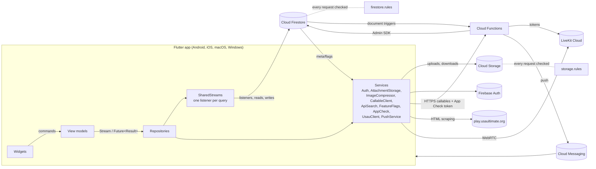
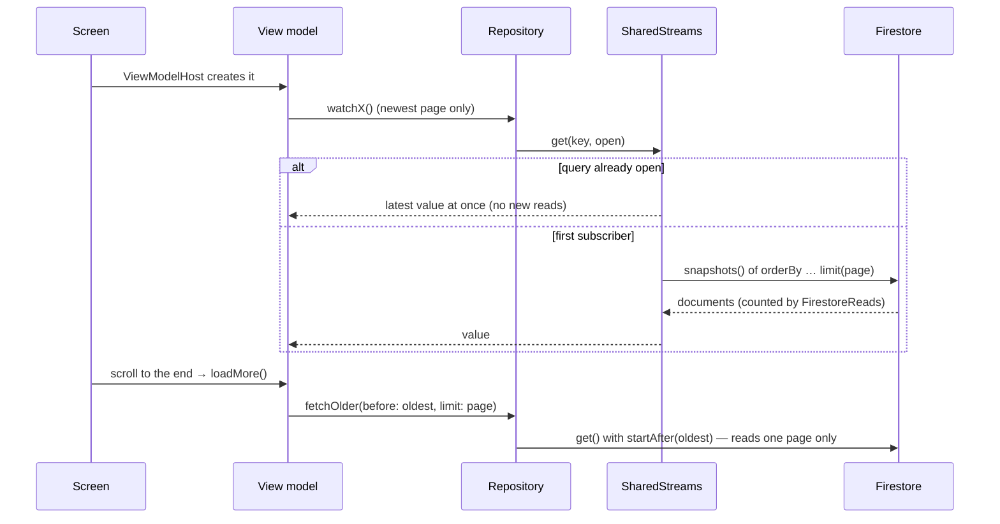

# Stall 10 architecture

How the app is put together as of version 0.0.12 (plus the
`hardening/scale-and-abuse` branch). It starts with what the app is and
how data moves through it, then the core architecture every feature
shares, then each feature's workflows and subfeatures. For setup see
`README.md`; for what users see, `docs/user-guide.md`; for operations,
`docs/rollback.md`, `docs/monitoring.md` and `docs/app-check.md`; for quotas
and costs, `docs/cloud-limits.md`.

**Contents**
1. [App overview](#1-app-overview)
2. [Core features](#2-core-features)
3. [Data flow diagram](#3-data-flow-diagram)
4. [Core architecture](#4-core-architecture)
5. [Feature workflows and subfeatures](#5-feature-workflows-and-subfeatures)
6. [Operations](#6-operations)

---

## 1. App overview

Stall 10 is an ultimate frisbee app for teams, community groups, schools
and clubs, and the players in them. It's one Flutter app for Android, iOS,
macOS and Windows on a Firebase backend, plus a website: a static landing
the same Flutter app compiled for web at `/`, X-style: visitors browse the
public feed, search, profiles, team pages and events (through the `browse`
functions), members also get their home feed; everything else says "get the
app". Static pages (`/about`, `/privacy`, `/terms`…) sit beside it.

| | |
|---|---|
| **Client** | Flutter, following the official Flutter MVVM guide: services → repositories → view models (`ChangeNotifier` + `Command`) → widgets. DI with `provider` (no Riverpod); routing with `go_router`. |
| **Backend** | Firebase: Auth, Cloud Firestore (app data), Cloud Storage (photos, files, videos), Cloud Messaging (push), Cloud Functions v2 (TypeScript), App Check, Hosting (landing page, web app, invite and join pages). |
| **Trust boundary** | Hybrid. Most reads and writes go straight from the app to Firestore and Storage, checked by `firestore.rules` and `storage.rules`. Cloud Functions sit beside the database for what rules can't do: rate limits and flood control, server-side search, third-party tokens (LiveKit), notifications, counters and cascades. |
| **Third parties** | LiveKit Cloud (meetings and voice channels), YouTube (video embeds and oEmbed), OpenStreetMap and Nominatim (group maps), Discord server templates (import), play.usaultimate.org (scraped on-device). |
| **Environments** | `frisbee-app-brianrhonea-dev` (dev, default; TestFlight from `development`) and `frisbee-app-brianrhonea` (prod; App Store from `main`). |

### Source layout

```
lib/
  main.dart                 Firebase + App Check init, emulators, providers, MaterialApp.router
  main_web.dart             The website's entry point: same providers, web router
  config/dependencies.dart  Every service and repository, provided app-wide
  routing/                  routes.dart (paths), router.dart (GoRouter tree, auth redirect),
                            web_router.dart (the website's subset), route_builders.dart (shared pages)
  domain/models/            Plain Dart models; no Firebase types
  domain/tournament_engine/ Pure-Dart bracket and schedule generation
  data/services/            Thin wrappers over platform, SDK and HTTP
  data/repositories/<x>/    <x>_repository.dart (abstract) + implementation(s)
  ui/core/                  Theme, adaptive shell, shared widgets
  ui/<feature>/view_models/ ChangeNotifiers that own state and Commands
  ui/<feature>/widgets/     Screens and widgets; render view-model state only
  utils/                    Result, Command, platform support flags
functions/src/              Cloud Functions, one folder per deploy group
  account/ api/ communities/ discord/ follows/ meetings/ notifications/
  usau/                     USA Ultimate scrapers (deliberately not deployed)
functions/test/             Unit tests and rules tests (emulators)
hosting/                    Landing page, join and invite pages (copied into build/site)
web/                        Flutter web shell (index.html, manifest, icons)
scripts/build_site.sh       Builds build/site: the web app at /, hosting/ pages beside it
scripts/monitoring/         Text-alert setup (Cloud Monitoring)
.github/workflows/          Deploy and roll back the backend
firestore.rules, storage.rules, firestore.indexes.json, firebase.json
```

---

## 2. Core features

| Area | What people can do |
|---|---|
| **Accounts** | Sign up and sign in with email, username, Google or Apple (browser OAuth for Google on Windows); pick a unique @username; delete the account. |
| **Home** | This week's events, your team, a playbook preview, coming-up events, a rankings podium and a feed of posts from people, teams and tournaments you follow. |
| **Teams** | Create a team, join by invite code, link or invite; custom roles with Discord-style permissions; roster imported and synced from USA Ultimate; team home page and public page. |
| **Community groups, schools and clubs** | Open or approval-only groups with a map location; schools and clubs that link several teams and hand out membership by role. |
| **Chat** | Team text rooms in folders with per-role and per-person access, photos and files; drop-in voice channels; 1:1 direct messages; Discord server import. |
| **Schedule** | Team and personal events, RSVPs, reactions, polls, public events, community events limited to roles, reminders. |
| **Meetings** | Scheduled team video calls with invites, lobby approval, screen share, in-call chat and watch-together video. |
| **Playbook** | Draw plays on a field and animate them step by step. |
| **Videos** | Team film: YouTube links or uploaded files, in folders. |
| **Stats** | Live game tracking (lines, O/D, pull timer, timeouts), stat sheets, season stats. |
| **Group tournaments** | Teams built from RSVPs, generated schedules and brackets, captain-reported scores. |
| **Social** | Profiles (public or private), follows and follow requests, posts with photos, links and workouts, likes, reposts, comments; GPS run and ride recording. |
| **USA Ultimate** | Tournaments, schedules, brackets, rankings and team pages. |
| **Search** | Explore and the Ctrl/⌘ K command menu over players, teams, groups and USAU events. |
| **Notifications** | Feed, push on phones, in-app bubbles, per-category, per-team and per-room settings. |
| **Settings** | Theme, privacy (read receipts, profile visibility), account. |

---

## 3. Data flow diagram

### Whole system



### A write, end to end (sending a chat message)

```mermaid
sequenceDiagram
  participant U as User
  participant VM as MessageThreadViewModel
  participant R as ChatRepository
  participant IC as ImageCompressor
  participant ST as Cloud Storage
  participant FS as Firestore + rules
  participant F as Functions (api, notifications)
  U->>VM: type, attach photo, tap Send
  VM->>IC: shrink photo (isolate)
  VM->>R: sendMessage
  R->>ST: upload attachment (storage.rules: room writer, ≤ 10 MB)
  R->>FS: create message (rules: can write room, not muted)
  FS-->>VM: live snapshot shows it ("Sending…" until server time)
  FS->>F: onDocumentCreated
  F->>F: teamMessageFlood: count in limits/{uid}; over 20/min → delete + mute 10 min
  F->>F: chatMessage: feed entries + push to readers
```

### A read, end to end (opening a list)



---

## 4. Core architecture

### 4.1 Layers and building blocks

| Piece | What it does |
|---|---|
| `Result<T>` (`utils/result.dart`) | Every fallible repository call returns `Ok(value)` or `Error(exception)`. `guard()` wraps a body and catches `Exception`s. |
| `Command0` / `Command1` (`utils/command.dart`) | A view-model action with `running`, `completed`, `error` and `result`. It can't run twice at once. Screens listen to commands to show snackbars or navigate. |
| `ViewModelHost` (`ui/core/ui/view_model_host.dart`) | Creates a view model once per route (or tab) and disposes it when the route leaves. Router rebuilds don't reset state. |
| `SharedStreams` (`data/services/shared_streams.dart`) | One upstream Firestore listener per query key for the whole app. Late subscribers get the latest value at once; the listener stays open 5 minutes after the last one leaves, so moving between screens doesn't re-read. |
| `countedSnapshots` / `FirestoreReads` (`firestore_utils.dart`) | Wraps queries so debug builds log how many documents each label reads. |
| `pageAfter()` (`firestore_utils.dart`) | Cursor query for the next older page: `orderBy(field).startAfter([value, id]).limit(n)`. |
| `muteAware()` / `RateLimitedException` | Turns a rules denial caused by a flood mute into "You're going too fast…". |
| `plainData()` | Converts Firestore `Timestamp`s to `DateTime` so domain models stay Firebase-free. |

### 4.2 Dependency injection

`config/dependencies.dart` builds `firebaseProviders`, installed by
`main.dart` with `MultiProvider`. Everything is one instance for the
app's lifetime. View models are not provided globally: each route makes
its own through `ViewModelHost(create: (c) => XViewModel(repo: c.read(), …))`,
and tests swap in the fakes in `test/testing/`.

| Provided | Implementation | Depends on |
|---|---|---|
| `FeatureFlags` (`ChangeNotifier`) | Live `meta/flags` doc (kill switches) | – |
| `CallableClient` | Callables over raw HTTPS (no `cloud_functions` plugin on Windows), adds ID and App Check tokens | – |
| `ApiSearch` | `api-search` callable | `CallableClient`, `FeatureFlags` |
| `AuthService`, `AccountService` | Firebase Auth + Google/Apple; `account-*` functions | – |
| `AuthRepository` (`ChangeNotifier`) | `AuthRepositoryFirebase` | `AuthService`, `AccountService` |
| `AttachmentStorage` | Storage uploads (year-long `Cache-Control`), downloads, deletes | – |
| `TeamRepository` | `TeamRepositoryFirebase` | `AttachmentStorage`, `ApiSearch` |
| `ProfileRepository` | `ProfileRepositoryFirebase` | `ApiSearch` |
| `PlayRepository`, `EventRepository`, `FollowRepository`, `VideoRepository`, `GroupTournamentRepository`, `PostCommentRepository` | Firebase implementations | – |
| `TeamPostRepository`, `UserPostRepository` | Firebase implementations | `AttachmentStorage` |
| `ChatRepository`, `DirectMessageRepository` | Firebase implementations | `AttachmentStorage` (DMs also `ApiSearch`) |
| `FilePickerService` | `file_picker` + `ImageCompressor` | `FeatureFlags` (`compress_images`) |
| `MeetingTokenService`, `MeetingRepository` | `meetings-joinToken` over HTTPS; Firebase | – |
| `MeetingMediaService`, `MeetingPresence`, `MeetingSettingsRepository` | LiveKit; in-memory; SharedPreferences | – |
| `VoiceRepository` (`ChangeNotifier`) | `VoiceRepositoryLiveKit`, one voice channel for the whole app | `meetings-voiceToken` |
| `DiscordImportRepository` | `discord-previewTemplate`, then client writes | `CallableClient` |
| `YouTubeInfoService`, `GeocodingService`, `LocationService` | oEmbed, Nominatim, geolocator | – |
| `WorkoutRecorder` (`ChangeNotifier`) | GPS run/ride recording, app-wide | `LocationService` |
| `PushService`, `NotificationRepository` | `firebase_messaging` (no-op on Windows); Firebase | – |
| `StatsRepository` | `StatsRepositoryFirebase` | `TeamRepository` |
| `UsauClient` + `Tournament`, `Ranking`, `UsauTeam`, `UsauSchedule` repositories | On-device scraping (`…Usau` implementations) | `UsauClient` |
| `ThemeRepository` (`ChangeNotifier`) | `ThemeRepositoryPrefs`, loaded before `runApp` | – |

### 4.3 Navigation

- `GoRouter` (`routing/router.dart`) refreshes on auth. `authRedirect()`
  holds users on a splash until auth is ready, sends signed-out users to
  sign-in (remembering `from`), sends users without a username to
  `/welcome/username`, and keeps signed-in users off the auth pages.
- **Shell:** a `StatefulShellRoute.indexedStack` with five tabs (Home,
  Teams, Schedule, Events, Rankings), each with its own stack.
  `AdaptiveShell` shows a bottom bar under 720 px and a rail above.
- **Full-screen pages** (events, USAU tournaments and teams, plays, stats,
  chat rooms, DMs, profiles, posts, the composer) use the root navigator
  and `context.push`, so back returns where you were. Path helpers are in
  `routing/routes.dart` (`Routes.teamChat(id)`, `Routes.conversation(id)`…).
- **Team pages:** one page with a tab bar of `TeamSection`s. Section
  routes are siblings of `:teamId` that build the same page key, so
  switching tabs updates the page in place.
- **Responsive:** Home is a two-column dashboard at 960 px; chat and
  Messages split list and conversation at 840 px; Settings pages slide in
  as a 440 px panel on wide windows.
- **Shortcuts:** `AppShortcuts` handles Ctrl/⌘ K (command menu) and
  Ctrl/⌘ 1–5 with a `HardwareKeyboard` handler, so they work whatever has
  focus.

### 4.4 How data reaches the screen

1. **Repositories** expose `Stream`s for live data and `Future<Result<T>>`
   for one-off reads and writes. Firebase implementations map
   `snapshots()` to sorted domain models through `SharedStreams`.
2. **View models** subscribe in their constructor, store the latest
   value, call `notifyListeners()`, record errors for the screen, and
   cancel everything in `dispose()`.
3. **Widgets** rebuild with `ListenableBuilder(listenable: vm)` and act
   through `vm.someCommand.execute(arg)`.

**Paging.** Long lists show a live first page and fetch older pages one
at a time with cursors (`fetchOlderMessages`, `fetchPostsBefore`). Items a
new arrival pushes out of the live page are kept, and items pulled back
in are de-duplicated. Chat history, DMs, meeting chat and the home feed
page this way. Notifications and comments stop at the newest 100; team
lists (rooms, roster, plays, folders, roles) are bounded by team size.

**Role-dependent listeners.** Some queries change with the user's role
because rules would deny them otherwise: roster status and the invite
code only for admins; chat rooms as the whole collection for editors,
or merged `readRoles`/`readUsers` queries for players; meetings and
community events per invited role.

**Pending writes and offline.** Firestore's cache shows a user's own
writes at once; messages show "Sending…" until `createdAt` arrives.
Attachments upload before the message is written and are deleted again
if the write fails; they aren't offline-capable.

**USA Ultimate caches.** The USAU repositories are app-wide singletons
with in-memory caches (one tournaments future, ranking divisions as they
parse, one future per team page and schedule key). `UsauClient` sends
requests one at a time, about a second apart, with a 30-second timeout.
Nothing from USAU is stored on disk.

### 4.5 Server layer (Cloud Functions)

Functions are deployed by group, never all at once (the USAU scrapers
stay undeployed). Every group runs under `setGlobalOptions({maxInstances: 10})`
so a flood can't scale the bill, and every callable sets
`enforceAppCheck` (on when `ENFORCE_APP_CHECK=true`).

| Group | Functions | Kind |
|---|---|---|
| `account` | `signInEmail` (username sign-in, rate limited 10 per 15 min per name), `deleteAccount` | HTTPS |
| `api` | `search` (people, players, teams; 50 results; rate limited), `health` (uptime check) | Callable, HTTP |
| `api` | `teamMessageFlood`, `directMessageFlood`, `meetingMessageFlood`, `postFlood`, `commentFlood`, `followFlood`, `joinRequestFlood`, `teamFlood` | Firestore create triggers |
| `communities` | `sync` (school/club membership by role) | Firestore trigger |
| `discord` | `previewTemplate` (reads a public Discord server template) | Callable |
| `follows` | `followCount`, `commentCount`, `profileDeleted`, `teamDeleted`, `groupTournamentDeleted`, `userPostDeleted` | Firestore triggers |
| `meetings` | `joinToken`, `voiceToken` (LiveKit tokens), `closeRoom` | HTTPS, trigger |
| `notifications` | `chatMessage`, `directMessage`, `teamEvent`, `teamMeeting`, `teamPlay`, `groupJoinRequest`, `teamInvite`, `userPost`, `postLiked`, `newFollower`, `followRequest`, `postCommented`, `teamPost`, `eventReminders` (hourly) | Triggers, schedule |

**Flood control.** Each trigger counts the author's creates per action in
a fixed window, in a transaction on `limits/{uid}`. Limits are in
`functions/src/api/model.ts` (for example 20 messages a minute). Past the
limit the extra document is deleted and `mutedUntil` is set 10 minutes
ahead. `firestore.rules` checks `notMuted()` on every create of those
kinds, so a muted client is refused at the database. Clients can read
their own `limits` doc but never write it.

**App Check.** `AppCheck.activate()` runs at startup: Play Integrity on
Android, App Attest (DeviceCheck fallback) on Apple, debug providers in
debug builds and a debug token (`APP_CHECK_DEBUG_TOKEN`) on Windows. HTTP
calls carry the `X-Firebase-AppCheck` header. Enforcement rolls out as
described in `docs/app-check.md`.

### 4.6 Data storage

#### Cloud Firestore

```
users/{uid}                     private profile, readReceipts (owner only)
  dmReads/{conversationId}      own read time per conversation
  events/{eventId}              personal schedule
  teamInvites/{teamId}          invites to join a team (team admins write)
  settings/notifications        categories, team overrides, mutedRooms, utcOffsetMinutes
  devices/{fid}                 push targets
  notifications/{id}            feed entries (Functions write)
  follows/{type_targetId}       what the user follows, with a notify bell
profiles/{uid}                  public directory: name, username, keywords, photo, private flag,
                                and public details unless the profile is private
  private/details               details of a private profile (followers read)
  followRequests/{uid}          asking to follow a private profile
usernames/{name}                → {uid}; claimed once, freed by Functions on delete
posts/{postId}                  people's posts: text, photos, links, workouts, tags, likes, reposts
  comments/{commentId}          comments (capped at the newest 100 on screen)
followCounts/{key}              followers / following (Functions only)
limits/{uid}                    flood counters and mutedUntil (Functions only; owner reads)
inviteCodes/{code}              → {teamId}; single lookups only
teamDirectory/{teamId}          public team search listing
tournamentDirectory/{g_t}       public group-tournament listing
teams/{teamId}                  team, group, school or club: members, roles, memberPerms, links
  private/invite, joins/{uid}   invite code and proof of knowing it
  joinRequests/{uid}            approval-group requests
  linkRequests/{teamId}         a team asking to join a school or club
  roster/{id}, rosterStatus/{id}
  plays/{id}, events/{id}, publicEvents/{id}, posts/{id}
  videos/{id}, videoFolders/{id}
  chats/{roomId}                text or voice room with access lists
    messages/{id}
  chatFolders/{id}
  meetings/{id}                 + requests/{uid}, messages/{id}, playback/current
  groupTournaments/{id}         + games/{id}
  statsTournaments/{id}, statsGames/{id}
conversations/{uidA_uidB}       DM header: participants, names, last message, readAt
  messages/{id}
usau_tournaments, usau_rankings Functions only (scrapers not deployed)
meta/{id}                       flags (kill switches), health, usau (Admin SDK writes)
sentReminders/{key}             reminder de-duplication (Functions only)
```

- **Denormalisation:** `memberIds` mirrors `members` for `array-contains`;
  `memberNames` and conversation `names` avoid profile reads; room read
  lists include writers.
- **Cascades:** Firestore doesn't delete subcollections, so
  `deleteTeam` (after stamping `deletingAt` so notifications stay quiet)
  and `deleteAccount` clear them; the `follows` functions remove follows
  of deleted people, teams and tournaments and a deleted post's photos.
- **Indexes** (`firestore.indexes.json`): composite indexes for every
  multi-field query (feed `authorId in`/`tournamentKey in` + `createdAt`,
  community events `audience` + `startsAt`, collection-group `follows`,
  `events.startsAt`, `notifications.createdAt`). `fieldOverrides` turn
  indexing off for large fields that are never queried (message text and
  attachments, post body, images, links and workout, comment body,
  profile bio and stats, directory descriptions), which makes writes
  cheaper.

#### Cloud Storage

```
teams/{teamId}/chats/{roomId}/{uid}/{messageId}/{i}-{name}   team chat attachments
conversations/{uidA_uidB}/{uid}/{messageId}/{i}-{name}       DM attachments
teams/{teamId}/posts/{postId}/{upload}/{i}-{name}            team post photos
users/{uid}/posts/{postId}/{upload}/{i}-{name}               people's post photos
teams/{teamId}/videos/{videoId}/{name}                       uploaded team videos (≤ 500 MB)
```

- **Images** are shrunk on the device before upload (`ImageCompressor`):
  at most 1920 px on the long side, JPEG quality 80, EXIF orientation
  baked in, transparent PNGs kept as PNG, GIF/HEIC untouched, and the
  original kept if the result isn't smaller. Picks up to 50 MB are
  allowed because they shrink under the 10 MB upload cap.
  `functions/scripts/compress-existing-images.ts` does the same to old
  uploads.
- **Paths are unique,** so uploads are marked `public, max-age=31536000, immutable`.
- **Downloads** go through the SDK, so rules apply to every read.

#### On device

`shared_preferences` (theme, meeting devices and volumes), Firestore's
offline cache, `SharedStreams` in memory, USAU data and image bytes in
memory only.

### 4.7 Security model

The rules are the security boundary; the UI only hides what people can't
do. Team membership is validated only by `firestore.rules`, so client and
rules change together (with tests in `functions/test/rules`).

| Data | Read | Write |
|---|---|---|
| `users/{uid}` and its subcollections | That user | That user (feed: Functions create; the user marks read or deletes) |
| `profiles/{uid}` | Signed-in users; `private/details` only followers of a private profile | That user, known fields only |
| `usernames` | Signed-in users | Claimed once with the profile, never updated |
| Team doc | Members (groups: anyone signed in can list) | Field-by-field: details by `manageTeam`; roles and ownership by the owner; joining needs the invite-code proof, an open group, or an approved request |
| Invite code | `manageMembers` | Owner, with the matching `inviteCodes` lookup |
| Roster / roster status | Members / admins | Admins |
| Plays, events | Members (community events: the roles in `audience`) | `manageEvents`; members write only their own RSVP, reaction and vote |
| Chat rooms and messages | Roles and people the room lets read | Room writers, as themselves, not muted; delete: author or `moderate` |
| Chat attachments | Same as messages (Storage reads the room) | Room writers, own folder, 10 MB |
| Meetings | Admins and invitees | Admins create, start, end; invitees RSVP and request to join; chat while live |
| Videos, folders | Members | Admins; links stored as 11-char YouTube ids only |
| Group tournaments and games | Editors and players on its teams | Editors; captains report and confirm scores |
| Conversations and DMs | The two participants | Participants; your own messages only; not muted |
| Posts, comments | Signed-in users (private authors: followers) | The author, validated field by field; not muted |
| Follows, follow requests | That user / the two people | That user; private profiles need an accepted request |
| `followCounts`, `limits`, `sentReminders`, `usau_*`, `meta` | Signed-in (limits: owner; reminders: nobody) | Admin SDK only |

Storage rules use `firestore.get()`, which needs the Storage service
agent to hold the *Firebase Rules Firestore Service Agent* role.

### 4.8 External APIs

| API | Used for | Called from |
|---|---|---|
| Firebase Auth | Sign-in, account deletion | `AuthService` |
| Google OAuth (browser + loopback) | Google sign-in on Windows | `GoogleDesktopOAuth` |
| Firestore, Storage, FCM, App Check | App data, files, push, attestation | Repositories, `AttachmentStorage`, `PushService`, `AppCheck` |
| Cloud Functions (HTTPS) | Search, sign-in, tokens, Discord preview | `CallableClient`, `AccountService`, `MeetingTokenService` |
| LiveKit Cloud | Meeting and voice-channel audio, video, screen share | `meeting_call_livekit.dart` |
| YouTube oEmbed and embed | Link checks and playback | `YouTubeInfoService`, `youTubePlayer()` |
| OpenStreetMap tiles, Nominatim | Group maps and address search | `GroupMap`, `GeocodingService` |
| Discord templates (`discord.new`) | Server import | `discord-previewTemplate` |
| play.usaultimate.org | Tournaments, rankings, teams, rosters, schedules | `UsauClient` + `UsauParser` |

The USAU site's `robots.txt` disallows AI agents; development uses the
fixtures in `functions/test/fixtures/`.

---

## 5. Feature workflows and subfeatures

Each feature lists its main workflows (what happens, in order, across the
layers) and its subfeatures.

### 5.1 Accounts and sign-in

**Workflows**
- **Sign up:** `SignUpViewModel` checks the username live
  (`UsernameChecker` → `usernames/{name}`), creates the Auth user, then
  claims `usernames/{name}` and writes `profiles/{uid}` in one transaction.
- **Sign in with a username:** the app posts the username and password to
  `account-signInEmail`, which rate-limits per username, looks up the
  email server-side (so emails are never public) and returns a custom
  token.
- **Username gate:** `authRedirect` sends a signed-in user with no
  username to `/welcome/username?from=…` (`ChooseUsernameViewModel`).
- **Delete account:** the app removes its own data (events, settings,
  devices, feed, follows, posts, profile), then `account-deleteAccount`
  frees the username and deletes the Auth user; `follows` functions clean
  up others' follows.

**Subfeatures:** email/password, Google, Apple (Google and Apple hidden
on Windows except browser Google), sign-out unregisters the device first.

### 5.2 Home and the feed

**Workflows**
- **Open Home:** `HomeViewModel` composes `MySchedule` (team events +
  personal events), the user's teams, a playbook preview, USAU
  tournaments and rankings, the DM unread badge and `HomeFeed`.
- **Build the feed:** `HomeFeed` keeps one source per kind and adds or
  drops them as follows and teams change:
  - people (the user plus everyone followed): `posts where authorId in`,
    in chunks of 30
  - followed tournaments and events: `posts where tournamentKey in`
  - each team the user is on: all its posts
  - each followed team they're not on: its public posts
  - followed group tournaments outside the user's groups: that group's
    public posts with the tag

  Each source has a live page of 20; `mergeFeed()` de-duplicates and
  sorts newest first.
- **Scroll for older posts:** `loadMore()` finds the cutoff (the newest of
  the sources' oldest dates), fetches the next page from the sources at
  the cutoff with `fetchPostsBefore`, and repeats up to 5 rounds, so the
  merged feed has no gaps and each load reads about one page.

**Subfeatures:** two-column dashboard at 960 px, rankings podium, this
week strip, inbox badge, in-app notice bubbles.

### 5.3 Teams

**Workflows**
- **Create a team:** `CreateTeamViewModel` writes the team, its invite
  code (`private/invite` + `inviteCodes/{code}`), `teamDirectory` listing
  and default rooms (General, voice channels) in one batch. `teamFlood`
  counts team creation.
- **Join by code or link:** the joiner writes `joins/{uid}` with the code
  and adds themselves as a player in the same batch; rules check the
  code matches. Join links open `hosting/join.html`, which deep-links into
  the app.
- **Invite people:** admins write `users/{uid}/teamInvites/{teamId}`;
  `teamInvite` notifies them; accepting joins the team.
- **Roles and permissions:** owners create custom roles granting
  `TeamPermission`s (manageTeam, manageMembers, manageChats, manageEvents,
  moderate, keepStats). The team doc holds `roles`, `memberRoles` and the
  flattened `memberPerms` that rules check with `can(team, perm)`. Legacy
  coach and captain tiers are migrated to custom roles
  (`migrateTiersToRoles`) when the owner opens the team.
- **USA Ultimate roster:** `UsauRosterViewModel` finds the team on USAU,
  imports the roster, and later syncs changes; `rosterStatus` (paid, on
  USAU) is admin-only.
- **Team search and public page:** search goes to `teamDirectory`
  keywords (or `api-search` when `use_api_search` is on); non-members see
  the public page with public events and posts.

**Subfeatures:** team home (summary, upcoming events, posts), sections
(Events, Chat, Roster, Playbook, Videos, Stats, Members), member removal
by role matrix, transfer ownership, delete team (full cascade).

### 5.4 Community groups

A group is a team doc with `kind: 'community'`, so chat, events, posts,
members, the directory and notifications work unchanged.

**Workflows**
- **Join an open group:** `joinGroup` adds the user as a member directly.
- **Join an approval group:** `requestToJoin` writes `joinRequests/{uid}`
  (`groupJoinRequest` notifies organizers; `joinRequestFlood` limits it);
  `approveJoinRequest` adds the member and deletes the request in one
  batch.
- **Set a location:** `LocationPickerViewModel` searches Nominatim and
  saves coordinates; the group page shows an OpenStreetMap map.

**Subfeatures:** sections Events, Chat, Tournaments, Members; captain
shown as Organizer and player as Member; pickup events; group tournaments.

### 5.5 Schools and clubs

A school or club is a team doc with `kind: 'organization'`.

**Workflows**
- **Link a team:** admins create a team inside the community
  (`createTeamInCommunity`, both sides in one batch), or a team asks from
  its menu (`requestCommunityLink` → `teams/{orgId}/linkRequests/{teamId}`)
  and the community accepts or declines.
- **Membership by role:** `communities-sync` runs on every team write.
  Members who gain a role a linked team admits join it as players; those
  who lose it leave. It only removes people it added (`orgMembers`), sets
  `orgLinked` once both sides agree, and mirrors community roles onto
  teams that hold copies (`orgRoles`).
- **Role-gated events:** `audience` holds `everyone` or role ids; members
  who don't manage events query once per id they hold
  (`watchEvents(audience:)`). Notices and reminders go to the same people.

**Subfeatures:** Teams section, invite codes, Discord import split by
team, leaving a community.

### 5.6 Team chat and voice channels

**Workflows**
- **Open chat:** `ChatListViewModel` lists rooms and folders the user can
  read (editors: all rooms; players: merged `readRoles`/`readUsers`
  queries) and creates General if it's missing.
- **Read a room:** `MessageThreadViewModel` (shared by team rooms, DMs and
  meeting chat) shows a live newest page and fetches older pages one at
  a time as the user scrolls up (auto-load, with a spinner; falls back to
  a larger live window if a page fetch fails).
- **Send:** the composer always shows a Send button (Enter sends,
  Shift+Enter adds a line on keyboards). Photos are compressed, files
  checked against 10 MB, uploaded, then the message is written. See the
  [sequence diagram](#a-write-end-to-end-sending-a-chat-message).
- **Flood:** more than 20 messages a minute deletes the extras and mutes
  the sender for 10 minutes; the composer shows "You're going too fast".
- **Manage rooms:** `ChatRoomSettingsViewModel` sets name, folder and
  read/write access by role or person; `moderate` can delete others'
  messages.
- **Voice channels:** voice rooms are drop-in calls. `VoiceRepository`
  gets a token from `meetings-voiceToken`, joins the LiveKit room and
  stays connected while the user moves around the app, one channel at a
  time.
- **Discord import:** the owner pastes a server template link;
  `discord-previewTemplate` returns the roles, folders and rooms it would
  create; after a preview the app writes them under the rules. In a
  community, rooms are split between linked teams (`DiscordTeamSplit`).

**Subfeatures:** folders, day separators, photo and file bubbles, saving
files, per-room mute, notifications folded per room.

### 5.7 Direct messages

**Workflows**
- **Start a conversation:** `PeopleSearchViewModel` searches `profiles`
  keywords (or `api-search`), debounced; opening a person creates
  `conversations/{uidA_uidB}` if needed.
- **Chat:** same thread as team chat (paging, compression, flood limit via
  `directMessageFlood`).
- **Unread and receipts:** each conversation holds `lastMessageAt`,
  `lastSenderId` and `readAt`. Opening writes the user's own
  `dmReads` time, and the shared `readAt` only with read receipts on.
  Home counts conversations where someone else posted after the user read.

**Subfeatures:** split view at 840 px, read receipts setting,
notifications per conversation.

### 5.8 Schedule and events

**Workflows**
- **See the schedule:** `MySchedule` merges `watchMyTeams`, every team's
  events and personal events (re-listening with backoff on failure).
- **Create or edit an event:** `EventEditorViewModel` writes
  `teams/{id}/events/{id}` (and `publicEvents/{id}` when public);
  `teamEvent` notifies members when an editable field changes.
- **RSVP, react, vote:** members write only their own entries in `rsvps`,
  `reactions` and `votes`.
- **Reminders:** `eventReminders` runs hourly and notifies people about
  events 23–24 hours out who haven't said they can't go.

**Subfeatures:** personal events, polls, public events, swipe-to-delete by
role, community event audiences, meetings shown as events.

### 5.9 Meetings

Meetings live in `teams/{teamId}/meetings` (not `events`), because
non-admins may only see the ones they're invited to.

**Workflows**
- **Schedule:** `MeetingEditorViewModel` sets invited roles and people,
  times and whether approval is required. Invitees RSVP.
- **Start and join:** an admin starts it (`scheduled → live`);
  `teamMeeting` alerts invitees who said they're going, and
  `MeetingAlertsViewModel` shows a **Join** banner. Joining calls
  `meetings-joinToken`, which repeats the rules' checks and returns a
  6-hour LiveKit token.
- **Lobby:** with approval on, invitees write `requests/{uid}` and admins
  admit or deny.
- **Watch together:** an admin picks a team video; everyone plays it on
  their own device, synced through `playback/current` (seek when more
  than 1.5 s off; the presenter writes a heartbeat every 10 s). Another
  admin can take control; Stop deletes the doc.
- **End:** an admin ends it; `closeRoom` deletes the LiveKit room.

**Subfeatures:** camera, mic, screen share (Windows, macOS, Android),
device choice and per-person volume (`MeetingSettings`), in-call chat
(paged, flood-limited).

### 5.10 Playbook

**Workflow:** `PlayEditorViewModel` edits a play's elements, arrows and
animation steps on a drawable field and saves it to
`teams/{id}/plays/{id}`; `teamPlay` notifies members. Playback animates
the steps.

**Subfeatures:** Home preview, admins edit, members view.

### 5.11 Videos

**Workflows**
- **Add a YouTube link:** `VideoEditorViewModel` extracts the 11-char id
  (`TeamVideo.youtubeIdFrom`), checks it with YouTube oEmbed (warns about
  private or non-embeddable videos) and saves only the id.
- **Upload a file:** `uploadVideo` puts it at
  `teams/{teamId}/videos/{videoId}/{name}`, then writes the doc; the file
  is deleted if the write fails. 500 MB per file (app, Firestore and
  Storage rules) and 5 GB per team (app only).
- **Watch:** YouTube embed (`youtube_player_iframe`; WebView2 on Windows
  from a virtual host) or media_kit for uploads.

**Subfeatures:** folders (deleting one moves its videos to Unsorted),
thumbnails, quota display, watch together in meetings.

### 5.12 Stats

**Workflows**
- **Track a game:** `GameTrackerViewModel` records lines, O/D, points,
  the pull timer and timeouts into one `statsGames/{id}` doc.
- **Tournaments and season:** `TournamentViewModel` and `StatsViewModel`
  roll games up into stat sheets and season stats; the roster comes from
  the team.

**Subfeatures:** stats access via `keepStats` or `statKeepers`, profile
stats summary.

### 5.13 Group tournaments

**Workflows**
- **Build teams:** `team_builder.dart` deals the event's RSVPs into teams
  of a chosen size with a random captain.
- **Generate a schedule:** `generator.dart` makes round robin, pools +
  single elimination, single or double elimination (with an if-needed
  final), then fits games to time slots and fields without double-booking.
- **Report scores:** a captain reports, the other captain confirms (scores
  must match); confirming writes the game and the bracket slots it fills
  in one batch, and rules check each fill with `getAfter`.

**Subfeatures:** standings (wins, head to head, point difference, points
for), public listing in `tournamentDirectory`, follow a tournament.

### 5.14 Profiles, follows and posts

**Workflows**
- **Profile:** `PlayerProfileViewModel` shows details, teams, stats and
  posts. A private profile keeps its details in `profiles/{uid}/private/details`,
  readable only by followers.
- **Follow:** following writes `users/{uid}/follows/{type_targetId}`;
  `followCount` updates counts and `newFollower` notifies. A private
  profile needs a `followRequests/{uid}` the owner accepts
  (`followRequest` notifies). `followFlood` limits follows.
- **Post:** `PostComposerViewModel` writes `posts/{id}` with text,
  compressed photos, links, a workout or a tournament/event tag;
  `userPost` notifies followers with the bell on; `postFlood` limits it.
- **Interact:** likes (`postLiked`), reposts with a note (once per
  person), comments (`postCommented`, `commentCount`, `commentFlood`).
- **Record a workout:** `WorkoutRecorder` tracks a GPS run or ride across
  the app; finishing posts it as a workout with its route.

**Subfeatures:** username, pronouns, bio, visibility settings, Following
page, follow bells, follow buttons on teams, tournaments and events.

### 5.15 USA Ultimate events and rankings

**Workflows**
- **Tournaments:** `TournamentsViewModel` reads the cached tournaments
  list; `TournamentDetailViewModel` fetches schedules and brackets per
  event and division (`UsauScheduleRepository`).
- **Rankings:** the first listener starts the load; divisions arrive as
  they parse; later listeners get the cache.
- **Team pages:** one fetch per USAU team URL.

**Subfeatures:** follow a USAU event, tag posts with it, podium on Home.
When the user base grows, deploy the scrapers and switch to the
`…Firebase` repositories (see `functions/src/usau`).

### 5.16 Search and command menu

**Workflow:** the Explore page and Ctrl/⌘ K debounce input, then search
players and people (`profiles` keywords), teams and groups
(`teamDirectory` keywords) and USAU events. When `use_api_search` is on,
people and team searches go through `api-search`, which validates the
keyword, rate-limits per user and returns at most 50 results.

### 5.17 Notifications

**Workflows**
- **Deliver:** a trigger decides recipients (pure logic in `model.ts`),
  then `deliver()` checks each recipient's preferences (room mute, team
  override, category), writes a feed entry and pushes to each device by
  FID. Dead FIDs are deleted.
- **Fold:** chat, DMs, event changes and plays fold into one entry per
  room, conversation, event or play; repeats within 10 minutes while
  unread update the feed without pushing again.
- **Client:** `syncDevice` registers the device at sign-in; tapped pushes
  open their `route`; `InAppNoticesViewModel` shows a bubble for new
  entries while the app is open.

**Subfeatures:** per-category and per-team settings, per-room mute,
times in the recipient's UTC offset, feed pruned after 60 days. Windows
has the feed only (no FCM plugin).

### 5.18 Settings

**Workflow:** `ProfileViewModel` backs General (theme), Privacy (read
receipts, profile visibility) and Account (name, username, delete,
sign out), each a slide-over page.

---

## 6. Operations

### Secrets and configuration
- Firebase keys come from `secrets.local.json` / `secrets.prod.local.json`
  via `--dart-define-from-file`; native config files are gitignored;
  Codemagic injects them for iOS. Full rules are in `CLAUDE.md`.
- LiveKit and `WEB_API_KEY` are Cloud Functions secrets.
- `USE_EMULATORS=true` points Auth, Firestore and Storage at local
  emulators.

### Kill switches (`meta/flags`)
Read live by every running app (`FeatureFlags`):

| Flag | Default | Off means |
|---|---|---|
| `use_api_search` | `false` | Search queries Firestore directly |
| `compress_images` | `true` | Photos upload as picked |

### Caching
- On device: `SharedStreams` (one listener per query, 5-minute grace) and
  the Firestore cache.
- Hosting: images and CSS `max-age=86400, stale-while-revalidate=604800`;
  HTML `max-age=300, s-maxage=3600` at the CDN; the web app's entry files
  (`/index.html`, `main.dart.js`, `flutter_bootstrap.js`…) `no-cache`.
- Storage uploads: `max-age=31536000, immutable`.

### Deploy, roll back, monitor
- **Deploy and roll back:** GitHub Actions **Deploy backend** and **Roll
  back backend** (`docs/rollback.md`). Deploys tag `release-<env>-<time>`;
  rollback redeploys the previous tag. The USAU scrapers are never
  deployed by these workflows.
- **Text alerts:** `scripts/monitoring/setup-alerts.sh` creates SMS alerts
  for site and API downtime (`api-health`), function errors, traffic
  floods, Firestore read spikes and mass mutes (`docs/monitoring.md`).

### Testing and checks

```
flutter analyze && flutter test                 # unit, view-model and widget tests with fakes
cd functions && npm run build && npm test        # functions logic (USAU parser, notifications, api)
cd functions && npm run test:rules               # Firestore + Storage rules (emulators; needs Java)
```

Fakes in `test/testing/` implement every repository in memory. Run the
rules tests before deploying rules.

### Deployment status (dev)

| Piece | Status |
|---|---|
| Firestore rules and indexes | Deployed to dev with the flood mutes and index exemptions; prod has the earlier version |
| Storage rules | Deployed |
| Functions | `account`, `api`, `communities`, `discord`, `follows`, `meetings`, `notifications` on dev |
| USAU functions | Not deployed, on purpose |
| Hosting | Deployed to dev with CDN cache headers |
| App Check | In the app; enforcement off until rolled out |
| iOS builds | Codemagic (`codemagic.yaml`, `docs/ios-release.md`) |

### Known gaps
- Meetings: no screen share on iOS, no mic level, no reminders before a
  meeting.
- Direct messages have no blocking or reporting yet.
- Messages can't be edited; attachments aren't available offline.
- USAU data is fetched per device; the server-side cache (scrapers) is
  waiting for a bigger user base.
