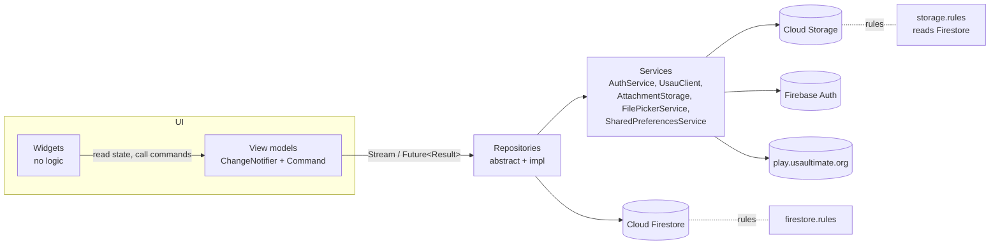

# UltiUP architecture

How the app is put together as of version 0.0.4 (branch
`feature/ultiup-schedule`): layers, features, where data lives, how it gets
to the screen, and who can see what. For setup see `README.md`; for what
users see, `docs/user-guide.md`.

## At a glance

- **Client:** one Flutter app for Android, iOS, macOS and Windows.
- **Backend:** Firebase only. Auth for sign-in, Cloud Firestore for app
  data, Cloud Storage for chat photos and files, Cloud Messaging for push.
  There's no app server. Every read and write goes straight from the app to
  Firebase, and `firestore.rules` and `storage.rules` are the security
  boundary. The only server code that runs is the `notifications` group of
  Cloud Functions, which reacts to writes and sends notifications.
- **USA Ultimate data:** scraped on-device from play.usaultimate.org and
  held in memory. Cloud Functions that would do this on a schedule exist in
  `functions/`, but are deliberately not deployed yet.
- **Architecture:** the official Flutter MVVM guide. Services → repositories
  → view models (`ChangeNotifier` + `Command`) → widgets. Dependency
  injection uses `provider` (no Riverpod) and routing uses `go_router`.



## Source layout

```
lib/
  main.dart                 Firebase init, emulators, providers, MaterialApp.router
  config/dependencies.dart  Every service and repository, provided app-wide
  routing/                  routes.dart (paths), router.dart (GoRouter tree, auth redirect)
  domain/models/            Plain Dart models; no Firebase types
  data/services/            Thin wrappers over platform/SDK/HTTP
  data/repositories/<x>/    <x>_repository.dart (abstract) + implementation(s)
  ui/core/                  Theme, adaptive shell, shared widgets (status views, dialogs)
  ui/<feature>/view_models/ ChangeNotifiers that own state and Commands
  ui/<feature>/widgets/     Screens and widgets; render view-model state only
  utils/                    Result, Command, platform support flags
functions/                  Cloud Functions (USAU scraping), parser tests, rules tests
firestore.rules, storage.rules, firestore.indexes.json, firebase.json
```

### The pieces each layer uses

| Piece | What it does |
|---|---|
| `Result<T>` (`utils/result.dart`) | Every fallible repository call returns `Ok(value)` or `Error(exception)`. `guard()` wraps a body and catches `Exception`s. |
| `Command0` / `Command1` (`utils/command.dart`) | A view-model action with `running`, `completed`, `error` and `result`. It can't run twice at once. Screens listen to commands to show snackbars or navigate. |
| `ViewModelHost` (`ui/core/ui/view_model_host.dart`) | Creates a view model once per route (or per tab) and disposes it when that route leaves. Router rebuilds don't reset state. |
| `plainData()` (`data/services/firestore_utils.dart`) | Converts Firestore `Timestamp`s to `DateTime` so domain models stay Firebase-free. |
| `ConstrainedContent` | Caps content width on wide screens. |

## Dependency injection

`config/dependencies.dart` builds `firebaseProviders`, which `main.dart`
installs with `MultiProvider` above the app. Everything is a single
instance for the app's lifetime:

| Provided | Implementation | Depends on |
|---|---|---|
| `AuthService` | Firebase Auth + Google/Apple sign-in, browser OAuth on Windows | – |
| `AuthRepository` (`ChangeNotifier`) | `AuthRepositoryFirebase` | `AuthService` |
| `AttachmentStorage` | Cloud Storage uploads, downloads and deletes | – |
| `TeamRepository` | `TeamRepositoryFirebase` | `AttachmentStorage` (deletes chat files with a team) |
| `PlayRepository` | `PlayRepositoryFirebase` | – |
| `EventRepository` | `EventRepositoryFirebase` | – |
| `ChatRepository` | `ChatRepositoryFirebase` | `AttachmentStorage` |
| `DirectMessageRepository` | `DirectMessageRepositoryFirebase` | `AttachmentStorage` |
| `FilePickerService` | `file_picker` open/save dialogs | – |
| `StatsRepository` | `StatsRepositoryFirebase` | `TeamRepository` (stats players are the roster) |
| `UsauClient` | HTTP + HTML parsing for play.usaultimate.org | – |
| `TournamentRepository` | `TournamentRepositoryUsau` (the alternative is `…Firebase`) | `UsauClient` |
| `RankingRepository` | `RankingRepositoryUsau` (the alternative is `…Firebase`) | `UsauClient` |
| `UsauTeamRepository` | `UsauTeamRepositoryUsau` | `UsauClient` |
| `UsauScheduleRepository` | `UsauScheduleRepositoryUsau` | `UsauClient` |
| `PushService` | `firebase_messaging` permission, FID registration, tapped-notification routes; no-op on Windows | – |
| `NotificationRepository` | `NotificationRepositoryFirebase` | `PushService` |
| `ThemeRepository` (`ChangeNotifier`) | `ThemeRepositoryPrefs` (shared_preferences), loaded before `runApp` | – |

View models are **not** provided globally. Each route creates its own
through `ViewModelHost(create: (c) => XViewModel(repo: c.read(), …))`.
Tests swap in the fakes from `test/testing/fakes.dart` the same way.

## Navigation

- `GoRouter` in `routing/router.dart` uses `refreshListenable: auth`.
  `authRedirect()` holds users on a splash page until auth is ready, sends
  signed-out users to sign-in (remembering `from`), and sends signed-in
  users away from the auth pages.
- **Shell:** a `StatefulShellRoute.indexedStack` with five branches: Home,
  Teams, Schedule, Events, Rankings. Each tab keeps its own navigation
  stack. `AdaptiveShell` shows a bottom `NavigationBar` under 720 px and a
  `NavigationRail` above.
- **Full-screen pages** sit outside the shell, or use
  `parentNavigatorKey: _rootKey`, and are opened with `context.push` so back
  returns where you were:
  - team events (`/team-events/…`) and personal events (`/my-events/…`)
    (team sections like `/teams/:id/events` stay in the Teams tab)
  - plays, stats screens and the USA Ultimate roster import
  - chat rooms and room settings (`/teams/:id/chats/…`)
  - direct messages (`/messages`, `/messages/new`, `/messages/:conversationId`)
- **Path helpers** are all in `routing/routes.dart`, for example
  `Routes.teamChat(id)` and `Routes.conversation(id)`.
- **Team pages:** `/teams/:id` is the team home (`TeamHomeScreen`). Each
  `TeamSection` (Team Events, Chat, Roster, Playbook, Stats, Members) is a
  child route, e.g. `/teams/:id/events`, shown by `TeamSectionScreen`. Old
  `?tab=` links redirect to the matching section.
- **Responsive layouts:** Home becomes a two-column dashboard when its
  content area is at least 960 px wide (`HomeScreen.dashboardBreakpoint`);
  below that it stays a single column.
- **Chat layout** (`ui/chat/widgets/chat_layout.dart`):
  - At 840 px or wider (`chatSplitBreakpoint`), team chat and Messages show
    the list on the left and the open conversation on the right.
  - Picking a chat changes the selection held in `ChatListViewModel` or
    `InboxViewModel`. The right pane is a `ViewModelHost` keyed by that
    chat, so switching disposes the old thread's subscriptions.
  - On phones, picking a chat pushes its route with a slide-in transition
    (`chatPage`). The page's top-left Chats button opens a `Drawer` holding
    the same list. Picking another chat replaces the page; picking the open
    one closes the drawer.

## Core features

| Feature | Screens | View models | Repositories |
|---|---|---|---|
| Sign-in (email, Google, Apple; browser OAuth on Windows) | `ui/auth` | `SignInViewModel`, `SignUpViewModel` | Auth |
| Home: this week, my team, playbook preview, coming up, rankings podium, inbox badge | `ui/home` | `HomeViewModel` (composes `MySchedule`) | Auth, Team, Play, Event, Tournament, Ranking, DirectMessage |
| Teams: create, join by invite code, roles, members, roster | `ui/teams` | `TeamsViewModel`, `CreateTeamViewModel`, `TeamDetailViewModel` (sections) | Team, Play, Event |
| Team home: summary, section links, upcoming events, posts; public page for non-members; team search | `ui/teams` | `TeamHomeViewModel`, `TeamSearchViewModel` | Team, Event, TeamPost |
| USA Ultimate roster import and sync, USAU team search | `ui/teams` | `UsauRosterViewModel`, `UsauTeamSearchViewModel` | Team, UsauTeam, Ranking |
| Team chat: rooms with per-role and per-person read/write access, photos and files | `ui/chat` | `ChatListViewModel`, `ChatRoomViewModel`, `ChatRoomSettingsViewModel` | Chat, Team |
| Direct messages: search people by name, 1:1 conversations, unread tracking | `ui/messages` | `InboxViewModel`, `PeopleSearchViewModel`, `DirectChatViewModel` | DirectMessage |
| Schedule: team and personal events, RSVP, reactions, polls | `ui/schedule` | `ScheduleViewModel` (`MySchedule`), `EventEditorViewModel`, `EventDetailViewModel`, `MyEventDetailViewModel` | Event, Team |
| Playbook: draw plays, animate steps, play back | `ui/playbook` | `PlayEditorViewModel` | Play, Team |
| Stats: tournaments, live game tracking (lines, pull timer, timeouts), stat sheets, season stats | `ui/stats` | `StatsViewModel`, `TournamentViewModel`, `GameTrackerViewModel` | Stats, Event, Team |
| Events: USA Ultimate tournaments, schedules and brackets | `ui/tournaments`, `ui/events` | `TournamentsViewModel`, `TournamentDetailViewModel` | Tournament, UsauSchedule |
| Rankings: every USAU ranking list, team pages | `ui/rankings` | `RankingsViewModel`, `UsauTeamViewModel` | Ranking, UsauTeam |
| Notifications: feed with unread badge on Home, push on this device, per-category and per-team settings, per-room mute | `ui/notifications` | `NotificationsViewModel`, `NotificationSettingsViewModel` (mute lives in `ChatRoomViewModel`) | Notification, Team |
| Profile and settings: name, light/dark theme, notifications link, sign out, delete account | `ui/profile` | `ProfileViewModel` | Auth, Theme, Notification |

### Roles

`TeamRole` (`domain/models/team.dart`) has four values: **owner**,
**coach**, **captain** and **player**. Owner, coach and captain are
"editors". They manage the schedule, roster, playbook, stats, chat rooms
and invite code. Players are read-only, but the owner can give a player
stats access (`statKeepers`). The owner alone sets roles, mints invite
codes, transfers or deletes the team, and moderates chat. The same matrix
is enforced in `firestore.rules`, so the client and the rules must change
together.

### Shared message thread

Team rooms and direct messages share one implementation:

- `MessageThreadViewModel` handles paging (50 at a time), draft
  attachments, the 10 MB check, sending, deleting, saving files, and
  per-attachment download caching.
- `MessageThreadView` is the message list, day separators, photo and file
  bubbles, and the composer (Enter sends, Shift+Enter adds a line).
- `ChatRoomViewModel` and `DirectChatViewModel` only supply where messages
  come from and go, plus who can post or moderate.

## How data reaches the screen

### Pattern

1. **Repositories expose `Stream`s for live data and `Future<Result<T>>`
   for one-off reads and writes.**
   - Firebase repositories return `query.snapshots().map(parse)`. Each
     snapshot becomes a fresh, sorted list of domain models, so view
     models never see Firestore types.
   - Writes go through `guard()` and return `Result`.
2. **View models subscribe in their constructor** and keep the
   `StreamSubscription`s.
   - Each update stores the latest value and calls `notifyListeners()`.
   - Each subscription has an `onError` that records an error for the
     screen to show.
   - Everything is cancelled in `dispose()`, which `ViewModelHost` calls
     when the route leaves.
3. **Widgets rebuild with `ListenableBuilder(listenable: vm)`.** They act
   by calling `vm.someCommand.execute(arg)` and listen to that command for
   the result.

### Are streams shared?

Not at the app level. Every `watchX()` call creates a new stream and its
own subscription. There's no repository-level fan-out (no `shareReplay`,
broadcast cache or global store). Sharing happens in three other places:

- **Firestore SDK.** All listeners run over one connection and one local
  cache per app. When two view models listen to the same query, the
  SDK de-duplicates them into one server target and serves both from the
  same cached view. So `watchTeam(id)` used by `TeamDetailViewModel`,
  `ChatListViewModel` and `StatsViewModel` at the same time costs one
  listener on the server.
- **Within a view model.** A view model may compose others:
  - `MySchedule` is a helper `ChangeNotifier` that merges
    `watchMyTeams(uid)` with every team's `watchEvents(teamId)` and the
    user's `watchMyEvents(uid)`. It also re-listens with backoff if
    personal events fail. `HomeViewModel` and `ScheduleViewModel` each
    create their own `MySchedule`, so Home and the Schedule tab hold
    separate subscriptions; Firestore still de-duplicates them.
  - `ChatRepositoryFirebase.watchRooms` for a player merges two queries
    (`readRoles array-contains <role>` and `readUsers array-contains <uid>`)
    into one stream, because the rules only allow queries that prove access.
- **USA Ultimate repositories** are app-wide singletons with in-memory
  caches. These are shared on purpose, because each fetch is slow and hits
  a third-party site:

| Repository | Cache | Shared how |
|---|---|---|
| `TournamentRepositoryUsau` | One `Future<List<Tournament>>` per app session | Every `watchTournaments()` awaits the same future; a failure clears it so a retry refetches |
| `RankingRepositoryUsau` | Divisions list plus one load future | The first listener starts the load; every open listener gets each division as it's parsed, and later listeners get the cached list immediately |
| `UsauTeamRepositoryUsau` | `Map<url, Future<UsauTeam>>` | One fetch per team page; dropped on failure |
| `UsauScheduleRepositoryUsau` | Maps keyed by event URL and (event, division) | One fetch per key; `refresh: true` refetches, reusing the schedule's own URL to skip a postback |

`UsauClient` sends requests one after another, about a second apart, with a
30-second timeout, to stay polite. The app never caches USA Ultimate data
on disk.

### Role-dependent subscriptions

Some listeners change with the user's role, because the rules would deny
them otherwise:

- `TeamDetailViewModel` watches `rosterStatus` (paid, USA Ultimate status)
  and the invite code only while the role is owner, coach or captain. It
  resubscribes when the role changes.
- `ChatListViewModel` resubscribes to rooms when the role changes. Editors
  get every room; players get the merged by-role and by-name queries. When
  an editor finds a team with no General room, they create it.

### Pending writes and offline

Firestore's local cache shows a user's own writes immediately. A message
stamped with `FieldValue.serverTimestamp()` arrives with a null
`createdAt` until the server confirms it; the UI shows "Sending…" for
those.

Chat attachments are not offline-capable. They upload to Storage before
the message document is written. If the message write fails, the uploaded
files are deleted again. If a Storage step fails partway, the file being
uploaded is removed too.

### Unread messages

Unread state is computed client-side from each conversation document. It
holds `lastMessageAt` and `lastSenderId`, plus `readAt[uid]` for each
person. Opening a conversation writes the opener's `readAt`. Home counts
conversations where someone else posted after the user last read.

## Storage

### Cloud Firestore

```
users/{uid}                     private profile: email, displayName, photoUrl (owner only)
  events/{eventId}              personal schedule (owner only)
  settings/notifications        categories {}, teams {teamId: {}}, mutedRooms [], utcOffsetMinutes
  devices/{fid}                 push targets: platform (owner writes, Functions send)
  notifications/{id}            feed: category, title, body, route, read, count (Functions write)
profiles/{uid}                  public directory: name, keywords (search prefixes), photoUrl
inviteCodes/{code}              → { teamId }; single lookups only, never listed
teamDirectory/{teamId}          public listing for team search: name, division, level,
                                city, keywords (copied from the team; editors write)
teams/{teamId}                  name, division, level, city, ownerId,
                                members {uid: role}, memberIds [], memberNames {},
                                statKeepers [], USAU link fields
  private/invite                current invite code (editors read, owner changes)
  joins/{uid}                   proof a joiner knew the code (rules check it)
  roster/{playerId}             name, number, position, userId (all members)
  rosterStatus/{playerId}       paid, onUsau (editors only)
  plays/{playId}                elements, arrows, animation steps
  events/{eventId}              team event, plus rsvps {uid}, reactions {uid}, votes {uid}, poll, public
  publicEvents/{eventId}        details of events marked public, no responses (anyone signed in reads)
  posts/{postId}                title, body, public, authorId, authorName (public ones: anyone reads)
  statsTournaments/{id}         tournament with roster and lines
  statsGames/{id}               one game: points, lines, timeouts, all in one doc
  chats/{roomId}                name, readRoles, writeRoles, readUsers, writeUsers
    messages/{messageId}        authorId, authorName, text, attachments [], createdAt
conversations/{uidA_uidB}       participants [a,b] (sorted), names {}, lastMessage,
                                lastMessageAt, lastSenderId, readAt {}
  messages/{messageId}          same shape as chat messages
usau_tournaments/{id}           written by Cloud Functions only (not deployed)
usau_rankings/{key}             written by Cloud Functions only (not deployed)
meta/usau                       last sync times (Functions only)
sentReminders/{key}             one per event and start time, so reminders go once (Functions only)
```

- **Denormalisation.**
  - `memberIds` duplicates `members`' keys so `watchMyTeams` can use
    `array-contains`.
  - `memberNames` and the conversation `names` avoid extra profile reads.
  - A chat room's read lists already include its writers, so the stored
    lists alone answer "who can read".
- **Cascades.** Firestore doesn't delete subcollections, so
  `TeamRepositoryFirebase.deleteTeam` clears every subcollection first:
  chat rooms (attachments, then messages, then the room), roster, plays,
  events, stats, joins and the invite code. `AuthRepositoryFirebase
  .deleteAccount` removes personal events, notification settings, devices
  and feed, `users/{uid}` and `profiles/{uid}`. Conversations stay for the
  other person. `deleteTeam` first stamps `deletingAt` on the team, so the
  notification functions don't announce every event the cascade removes.
- **Indexes.** All current queries use single-field indexes:
  `array-contains` on members, room access and participants;
  `orderBy createdAt / startDate / date`. Inbox order and people-search
  ranking are sorted client-side to avoid composite indexes. The
  reminder job and feed pruning need collection-group indexes on
  `events.startsAt` and `notifications.createdAt` (`firestore.indexes.json`).

### Cloud Storage

```
teams/{teamId}/chats/{roomId}/{uid}/{messageId}/{i}-{fileName}   team chat attachments
conversations/{uidA_uidB}/{uid}/{messageId}/{i}-{fileName}       direct-message attachments
```

- **Size cap:** 10 MB per file (`maxAttachmentBytes`), checked in the
  picker, the view model and `storage.rules`.
- **File names:** sanitised. Messages store each attachment's path, name,
  content type and size.
- **Downloads:** go through the SDK (`getData`), so the rules apply to
  every read. The app never uses public download URLs.
- **Windows:** the desktop SDK uploads the bytes and then sets the content
  type as a separate update, so the rules allow authors to create *and*
  update their own files.

### On-device

- `shared_preferences`: theme mode.
- Firestore's offline cache, which the SDK manages.
- USA Ultimate data and chat image bytes are held in memory only.

## Security model

The rules are the security boundary. The UI hides actions people can't
take, but the server enforces every one.

| Data | Read | Write |
|---|---|---|
| `users/{uid}`, personal events | That user | That user |
| `profiles/{uid}` | Any signed-in user | That user; name, keywords and photo only (no email) |
| Team doc | Members | Field-by-field paths: editors edit details; the owner sets roles, stats access and ownership; joining needs the code proof; removals follow the role matrix |
| Invite code | Editors | The owner, plus a matching `inviteCodes` lookup in the same batch |
| Roster | Members | Editors |
| Roster status | Editors | Editors |
| Plays, team events | Members | Editors; members write only their own RSVP, reactions and votes, and only when going |
| Stats | Members | Editors and stats keepers |
| Chat room details | Editors (to manage access); others only rooms they can read | Create and update: editors. Delete: owner |
| Chat messages | The owner, plus roles and people the room lets read | Create: the owner, plus roles and people the room lets write, posting as themselves. Delete: author or owner. No edits |
| Chat attachments | Same as messages (Storage rules read the room from Firestore) | Room writers, into their own folder, 10 MB max. Delete: author or owner |
| Conversations | The two uids in the id | Create: a participant, with the other person listed in `profiles`. Update: the preview or your own `readAt` only. No deletes |
| DM messages and attachments | The two participants | Your own only; delete your own |
| Notification settings, devices | That user | That user; known fields and categories only |
| Notification feed | That user | Functions create; the user marks entries read or deletes them |
| `usau_*`, `meta` | Signed-in users | Nobody from clients (Admin SDK only) |
| `sentReminders` | Nobody | Nobody from clients (Admin SDK only) |

Storage rules use `firestore.get()` to check team and room access. That
needs the Storage service agent to hold the **Firebase Rules Firestore
Service Agent** role on the project.

## External APIs

| API | Used for | Called from |
|---|---|---|
| Firebase Auth | Sign-in (email, Google, Apple), display name, delete account | `AuthService` |
| Google OAuth (system browser + loopback) | Google sign-in on Windows | `GoogleDesktopOAuth` |
| Cloud Firestore | All app data, real-time listeners | Firebase repositories |
| Cloud Storage | Chat and DM attachments | `AttachmentStorage` |
| play.usaultimate.org (HTML scraping, ASP.NET postbacks) | Tournaments, rankings, team pages and rosters, event schedules and brackets | `UsauClient` + `UsauParser` |

Notes on USA Ultimate data:

- The site's `robots.txt` disallows AI agents. Development work uses the
  fixtures in `functions/test/fixtures/`; the app itself fetches only the
  pages a user opens.
- When the user base grows, deploy `functions/` (scheduled
  `scrapeUsauTournaments` and `scrapeUsauRankings`, every two months to
  start). Then switch `dependencies.dart` to `TournamentRepositoryFirebase`
  and `RankingRepositoryFirebase`, which read `usau_*` from Firestore.

## Notifications

Cloud Functions in `functions/src/notifications`, exported as the
`notifications` group (`firebase deploy --only functions:notifications`):

| Function | Trigger | Who's notified |
|---|---|---|
| `chatMessage` | Team chat message created | Everyone who can read the room (`roomReaders` mirrors `canReadRoom`), except the author |
| `directMessage` | DM created | The other participant |
| `teamEvent` | Team event written | Every member but whoever did it (auth context), when an editable field changed; never for past events |
| `teamPlay` | Play created or saved | Every member but whoever saved it |
| `eventReminders` | Hourly | Events starting 23–24 h out: team members who haven't said they can't go, or the personal event's owner. Also prunes feed entries over 60 days old |

- **Delivery** (`deliver.ts`): for each recipient, read their preferences
  (`wants()`: room mute, then team override, then category; everything is
  on by default), write the feed entry, then send to each device by FID
  with `sendEach`. FIDs FCM no longer knows are deleted.
- **Folding:** chat, DMs, event changes and plays fold into one feed entry
  per room, conversation, event or play (`collapseId`). Repeats while it's
  unread count up ("3 new messages"); the same id groups pushes on the device.
- **Times** are worded in the recipient's offset (`utcOffsetMinutes`, written
  at each sign-in), since Functions run in UTC.
- **Client:** `_FrisbeeAppState` calls `syncDevice` when someone signs in,
  which registers the device if push is already allowed. Tapped pushes carry
  a `route` and are opened with `router.push` once auth is ready. Signing
  out (or deleting the account) unregisters the device first.
- **Platforms:** Android and iOS get push (iOS needs the APNs key in
  Firebase and Push on the App ID). macOS needs the Push capability added
  when its signing is set up. Windows has no FCM plugin, so it shows the
  feed only.
- **Logic** that decides recipients and wording is pure (`model.ts`) and
  unit-tested in `functions/test/notifications`.

## Secrets and configuration

- Firebase API keys come from `secrets.local.json` at build time, via
  `--dart-define-from-file`. `lib/firebase_options.dart` only reads
  `String.fromEnvironment`.
- Native Firebase config files and iOS Google IDs are gitignored. Codemagic
  injects them for iOS builds.
- `USE_EMULATORS=true` points Auth, Firestore and Storage at local
  emulators (ports 9099, 8080 and 9199).
- Full rules are in `CLAUDE.md`.

## Testing and checks

```
flutter analyze && flutter test                 # unit, view-model and widget tests with fakes
cd functions && npm run build && npm test        # USAU parser and notification logic tests
cd functions && npm run test:rules               # Firestore + Storage rules (emulators; needs Java)
```

- The fakes in `test/testing/fakes.dart` implement every repository in
  memory. Stream fakes subscribe to their change feed before emitting the
  first value, so updates made in reaction to that value aren't lost.
- Rules tests are in `functions/test/rules/`. Run them before deploying
  rules.

## Deployment status

| Piece | Status |
|---|---|
| Firestore rules | Deployed (`firebase deploy --only firestore:rules`) |
| Storage rules | Deployed (`firebase deploy --only storage`); Blaze plan and Storage enabled |
| Notification functions | Ready; deploy with `firebase deploy --only functions:notifications` |
| USA Ultimate functions | Not deployed, on purpose, until there are more users |
| Firestore indexes | Collection-group overrides for reminders and pruning; deploy with `firebase deploy --only firestore:indexes` |
| iOS builds | Codemagic (`codemagic.yaml`, `docs/ios-release.md`) |

## Known gaps

- Direct messages have no blocking or reporting yet.
- Messages can't be edited.
- Chat attachments aren't available offline.
- Each Home and Schedule visit opens its own `MySchedule` listeners; the
  Firestore SDK de-duplicates them, but a shared app-level schedule store
  would cut setup work if those screens get heavier.
