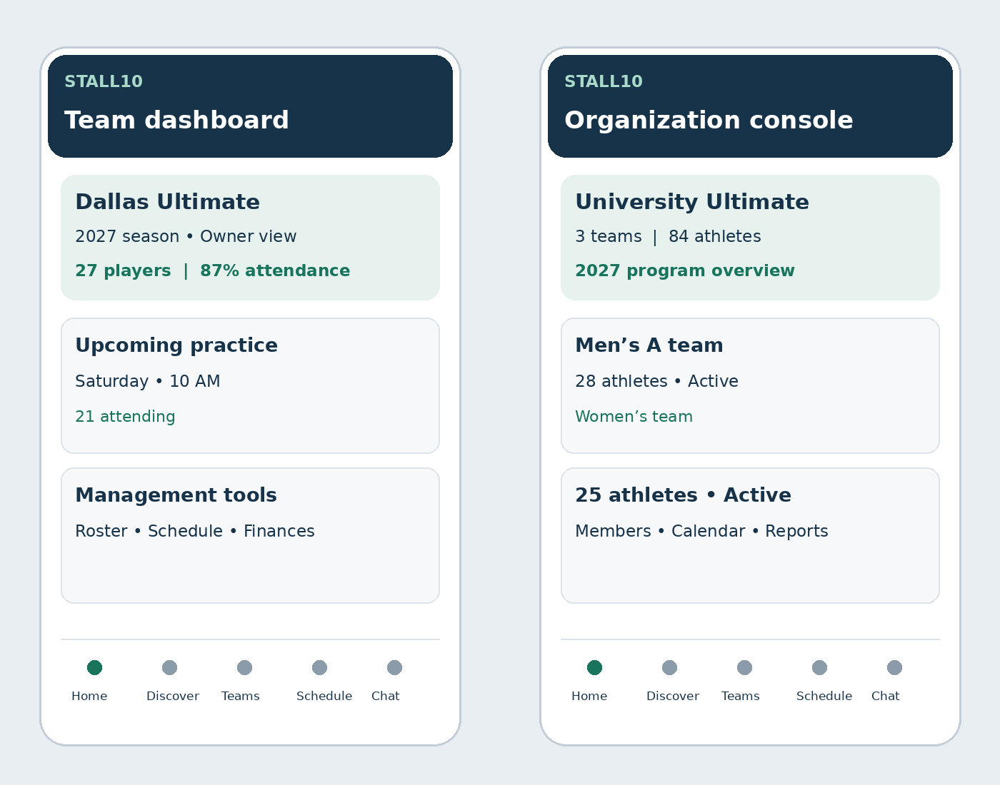

<!-- Converted from Stall10_04_Teams_Organizations_UI.docx; the Word original is kept alongside. Do not edit the requirements here without updating the source. -->

# Teams & Organizations

DOCUMENT 04  |  VERSION 1.0  |  25 NOVEMBER 2026

Approved product requirements • Proposed engineering design • Pre-launch

### Purpose

Make Stall10 the operational home for sports teams: manage membership, competitive seasons, recruiting, attendance, finances and organization oversight while retaining a permanent identity and athlete career history. Launch with ultimate; keep shared infrastructure sport-agnostic.

### Approved requirements (1–7)

| ID / capability | Required behavior |
|---|---|
| R01 Lifecycle | Permanent teams; separate seasons and archived history. |
| R02 Ownership | One owner, delegated administrators, confirmed transfers. |
| R03 Permissions | Granular permissions and customizable role presets. |
| R04 Rosters | Separate membership and season rosters; allow unregistered players. |
| R05 Recruiting | Listings, applications, tryouts, evaluations and offers. |
| R06 Attendance | RSVPs, actual attendance and private reports. |
| R07 Finances | Dues, individual charges, installments, expenses, online/offline payments. |

### Specification status

All R01–R14 are approved scope, not claims of implementation. Schemas, endpoints, defaults and release sequencing below are proposed. No additional product requirements were supplied.

## 02 / Requirements and existing foundation

| ID / capability | Required behavior |
|---|---|
| R08 Authority | Central oversight with team autonomy and scoped permissions. |
| R09 Subscriptions | Organization-wide coverage plus independent team plans. |
| R10 Visibility | Public/private controls and section-specific visibility. |
| R11 Eligibility | Configurable waivers, eligibility and guardian consent records. |
| R12 Branding | Logo, banner, colors, bio and shareable public page. |
| R13 Archival | Archive teams; preserve permitted career history and statistics. |
| R14 Portability | Permission-controlled roster, attendance, statistics and financial exports. |

### Observed development-branch foundation

TeamService validates creation, caller ownership, mute state, league eligibility, name clashes and club age. MembershipService handles expiring codes, invites, requests, membership, roles and organization linking. Access helpers enforce one owner, role grants and restricted removal. RosterService separates roster entries from members and filters visitor-facing rosters. Architecture documentation describes team posts, chat, meetings, events, playbooks, video and statistics; these are not independently tested here.

### Existing versus target

Current team documents hold memberIds, members, memberNames, roles, memberRoles, memberPerms and grants. Roster and rosterStatus are separate collections. Season statistics are documented, but a full season lifecycle is unverified. Paid marks are not a financial ledger. Join requests are not a full recruiting pipeline. Preserve existing behavior during migration.

## 03 / Team and season lifecycle

### Entity model

Retain teams/{teamId} with kind team, community or organization. A competitive team has one sportId; an organization may link teams across sports. Independent teams need no parent. Stable team IDs retain followers, branding and links. Seasons carry competitive division, level, dates and status. Ultimate positions and O/D lines belong to sport configuration, not universal membership.

### Season workflow

Owner or authorized manager creates a draft season, selects returning staff and roster entries, copies selected templates and playbooks, then activates the season. Prior season remains available as read-only history. Proposed default: one active competitive season per team, with draft future seasons; revisit overlapping competitions if needed. Close season with final statistics, financial reconciliation and roster snapshots. Corrections to closed records require permission, reason and audit trail.

### Membership and roster

Membership grants workspace access; roster entries represent participation. Coaches and staff need not be players. Unregistered players receive stable roster IDs and may claim a record through an approved, audited match; never auto-link by name alone. Season statuses: offered, active, practice player, reserve, inactive, former. Staff is a membership/roster designation, not an automatic permission grant. Injury detail is not required.

### Archival

Archive removes the team from active discovery and disables new activity, without deleting permitted historical records. Authorized owners may request restoration. Deletion and account erasure are separate workflows: redact or anonymize where appropriate, preserve legally required financial records, and apply athlete visibility to career history. Do not retain private data indefinitely by default.

### Acceptance

A returning athlete can join a new season without losing past statistics. A former player loses current private access but retains permitted career history. An archived team cannot accept new applications or charges.

## 04 / Ownership, permissions and organizations

Existing access.ts permits one owner, custom roles, individual grants and legacy coach/captain tiers. Target: server-calculated effective permissions; default deny; explicit organization scope. Legacy broad tiers migrate to presets after equivalence testing.

| Preset | Proposed default scope |
|---|---|
| Owner | All team actions; role administration, transfer, archive. |
| Manager | Team details, roster, members, events, moderation. |
| Coach | Roster, events, recruiting, playbook, film, stats. |
| Captain | Roster, events, recruiting, chat, playbook, stats. |
| Treasurer | Charges, expenses, reconciliation and finance exports. |
| Statkeeper | Record and correct authorized game statistics. |
| Player | Participate, RSVP, view permitted team resources. |

### Authorization rules

Add manageRoster, manageRecruitment, manageFinance, managePlaybook, manageFilm, manageEligibility, exportData and manageAttendance as proposed granular permissions. Owner-only role grants and transfer remain protected. Financial export requires finance scope in addition to export permission. Require recent authentication for sensitive changes. Transfer: owner initiates, eligible recipient accepts, transaction verifies both memberships and current owner, then logs transfer. Expire or cancel pending transfers; never leave a team ownerless.

### Organization scope

Both parties approve links. Organization administrators manage explicitly delegated teams and capabilities; organization membership alone does not unlock private chats, evaluations or finances. Role synchronization records grant provenance, preserves independent team membership and revokes inherited access on role removal or unlinking. Organization-wide subscription entitlement is separate from authorization; unlinking triggers a defined billing transition without deleting records.

### Acceptance

Test unauthorized role escalation, owner transfer races, organization unlinking, and removal of inherited access. A treasurer cannot read recruiting notes by virtue of financial access.

## 05 / Recruitment, attendance and eligibility

### Recruitment workflow

Publish listing with sport, season, level, eligibility, positions, dates and location preferences. Athletes opt in and submit an application with profile references and availability. Staff schedule tryouts as canonical events; applicants RSVP without gaining full team membership. Evaluators record private notes and structured scores. Staff select, waitlist or decline; offers expire or are withdrawn; acceptance plus required eligibility creates roster and appropriate membership atomically. Applicants can withdraw. Keep decision history and restrict evaluator access.

### Attendance

Keep RSVP intent separate from actual attendance. Authorized staff record present, absent, late, excused or unknown against a canonical event and season roster ID. Allow corrections with audit trail; report denominator and exclude canceled events. Private individual reports visible to athlete and authorized staff; no public attendance leaderboard. Optional check-in may be added later, not required.

### Waivers and eligibility

Version waiver text and eligibility rules by season/event. Record version, signer identity, timestamp, consent scope and guardian relationship when applicable. Require renewed acceptance for material changes. Store evidence in restricted records; expose completion status rather than documents to general staff. Current club age gate is 16+ and missing birth date blocks club joins; retain until policy review. Platform 13+ and minor privacy rules from Document 02 remain applicable. Guardian verification, legal enforceability and retention require jurisdiction-specific review before launch.

### Acceptance

An applicant cannot view private team content before admission. A declined or withdrawn offer cannot be accepted. A duplicate acceptance creates no duplicate roster. An RSVP does not count as attendance. A superseded waiver cannot satisfy a newly required version.

## 06 / Finances and subscription entitlements

### Team finance workflow

Authorized treasurer creates season dues or individual charges, assigns eligible players, sets due dates and optional installments, and records discounts or waivers. Athlete sees only own obligations and receipts. Record offline payments with method, amount, date and actor; corrections use reversals. Track expenses with category, amount, receipt and approval status. Export ledger and reconcile against payment provider records.

| Record | Proposed invariant |
|---|---|
| Charge / installment | Integer minor units, currency, due date, payer and season; sum of installments equals charge. |
| Payment | Unique provider reference or offline receipt; idempotent posting. |
| Refund / adjustment | Linked original transaction; no silent balance edits. |
| Expense | Separate from collected dues; audit author and supporting receipt. |
| Balance | Derived from posted charges, credits and settled payments; pending is not paid. |

### Online payments

Use approved payment-provider architecture (Document 10). Verify eligible recipients before collecting online dues, use hosted onboarding/checkout where appropriate, signed webhooks and reconciliation. Do not store bank credentials or operate an internal wallet. Payout, refund, dispute, tax and fee allocation rules remain open until payment specification; no assumption that tournament payout rules automatically apply to dues.

### Monetization

Proposed free baseline: team creation, roster, roles, schedule, chat, basic stats, playbooks, season history and manual dues. Premium candidates: advanced analytics, expanded storage, recruiting workflows, automated financial reporting and organization analytics. Organization plans cover eligible linked teams; independent team plans remain available. Prevent double billing, define entitlement precedence and grace periods in Document 11. No prices approved here.

## 07 / Experience, visibility and portability

### Web and mobile

Home dashboard: team branding, current season, upcoming events, roster summary, posts and role-aware actions. Team tabs: roster, schedule, chat, playbook, film, stats, recruiting and finances as enabled. Staff see pending applications, dues and waiver tasks only when authorized. Organization dashboard aggregates permitted team counts, schedules and reports. Maintain practical feature parity; desktop can optimize bulk editing and exports, mobile can optimize attendance and game-day workflows.

### Public pages and privacy

Provide logo, banner, colors, bio, shareable URL and configurable section visibility. Default public projection excludes private chat, finances, attendance, evaluations, consent records and contact information. Apply most restrictive applicable team, section, athlete and youth policy. Existing publicRoster filters private profiles and hides youth rosters; signed-in roster cards need equivalent policy review. Unregistered players should not be publicly identifiable without appropriate consent. Public team pages must not expose internal IDs or privileged metadata.

### Data portability

Allow authorized CSV exports of roster, attendance, statistics and finance records; include season, time zone, filters and generated timestamp. Scope rows and columns to caller permissions; financial exports require finance authority. Exclude guardian evidence, private evaluations and sensitive personal details by default. Generate large exports asynchronously with expiring authenticated links; log access and prevent spreadsheet formula injection. Athlete personal export remains separate from team administration.

### Acceptance

A public visitor cannot access private sections by direct URL. A minor is not exposed by a public roster or career history. A player cannot export other players’ financial records. Revoking permission prevents subsequent export retrieval.

## 08 / Proposed data and API architecture

All application writes through Fastify API; authorized Firebase reads for real-time views. Use Firebase Auth caller identity and server-side authorization. Signed media upload may be authorized and finalized through API per Document 01. Keep legacy reads compatible during migration.

| Firestore path (proposed) | Purpose |
|---|---|
| teams/{id} | Stable identity, sport, kind, owner, branding, activeSeasonId, visibility. |
| teams/{id}/members/{uid} | Roles, grants, provenance, status, joinedAt. |
| teams/{id}/seasons/{sid}/roster/{rid} | Athlete link or unregistered record; position, status, participation. |
| teams/{id}/seasons/{sid}/attendance/{id} | Event and roster references; actual attendance. |
| teams/{id}/recruitment/{id}/applications/{uid} | Listing, applicant, status, offer; restricted evaluations separately. |
| teams/{id}/seasons/{sid}/charges/{id} | Dues and installments; ledger records separate. |
| teams/{id}/eligibility/{id} | Restricted waiver/consent evidence and version. |
| teams/{id}/auditLogs/{id} | Actor, action, scope, timestamp, reason; no secrets. |

### Existing API contracts verified in routes.ts

POST /v1/teams creates team; GET /v1/teams/:teamId/roster returns signed-in roster; PUT /v1/teams/:teamId/roster-lines updates line assignments. Membership service operations exist; exact route inventory not verified.

### Proposed API extensions

Under /v1/teams/:id: POST seasons, PATCH seasons/:sid, POST seasons/:sid/activate, POST ownership-transfers and /:transferId/accept, PUT members/:uid/permissions, POST recruitment and applications, POST offers/:offerId/accept, PUT events/:eventId/attendance, POST charges, payments/offline, expenses, exports and archive. Use validated schemas, cursor pagination, idempotency keys for financial and acceptance actions, and transactions for state transitions. These are design candidates, not existing endpoints.

## 09 / Migration, testing and delivery

### Migration and risks

1. Inventory actual routes, rules and client writes; add parity tests. 2. Introduce sport configuration and season IDs with backward-compatible defaults; backfill current rosters and stats without inventing historical seasons. 3. Dual-read membership maps and subcollections, reconcile effective permissions and organization provenance; switch writes to API before tightening rules. 4. Add recruitment, attendance and eligibility; then financial ledger and verified payments. 5. Remove legacy fields only after reconciliation, rollback rehearsal and client upgrade coverage.

| Risk / source finding | Required verification |
|---|---|
| Bounded name lookup before creation | Concurrent create/rename; transactional reservation if uniqueness required. |
| Membership maps on team doc | Document size, contention, listener costs; migrate as needed. |
| Signed-in roster vs public filtering | Privacy and youth matrix; unlinked player consent. |
| Legacy broad admin tiers | No privilege expansion during migration. |
| Organization sync | Revocation, unlinking, duplicate memberships, race conditions. |
| Financial state transitions | Duplicate webhooks, refunds, disputes, offline reversals and reconciliation. |

### Proposed release sequencing

Launch foundation: API-only writes, privacy, roles, sport configuration, seasons, roster history, branding, basic recruiting, manual dues, attendance and basic exports. Post-launch: full tryout evaluations, verified online payments, advanced reports, organization analytics and richer eligibility workflows. All approved scope remains required; sequencing is proposed, not a reduction in scope. Legal and youth safeguards must precede any affected workflow.

### Operational acceptance

Run API unit and integration tests, Firebase emulator rules tests, concurrent mutation tests, mobile/web workflow tests and load tests for large teams. Measure reads, writes, latency and storage against the $50–$150 monthly infrastructure planning budget. No performance or cost results are asserted.

## 10 / Source references and open decisions

Repository: brianrhonea/frisbee_app, development branch. Source evidence reviewed in the requirements assessment:

https://github.com/brianrhonea/frisbee_app/blob/development/apps/api/src/teams/service.ts

https://github.com/brianrhonea/frisbee_app/blob/development/apps/api/src/teams/routes.ts

https://github.com/brianrhonea/frisbee_app/blob/development/apps/api/src/teams/access.ts

https://github.com/brianrhonea/frisbee_app/blob/development/apps/api/src/teams/membership.ts

https://github.com/brianrhonea/frisbee_app/blob/development/apps/api/src/teams/roster.ts

https://github.com/brianrhonea/frisbee_app/blob/development/docs/ARCHITECTURE.md

### Review limitations

Selected source files and architecture documentation were reviewed, not the complete repository. The attempted member_routes.ts lookup returned 404. Complete membership route inventory, season lifecycle, frontend parity, Firebase rules, automated tests and deployed behavior remain unverified. Architecture documentation may lag implementation. No repository files were modified.

### Decisions still requiring implementation validation

Proposed single active season default, role presets, transfer expiry, data retention periods, waiver and guardian verification methods, export expiry, sport-specific field catalog, billing entitlement precedence, payment fees and rollout milestones are not separately approved. Validate these before production. Legal review is required for consent and financial obligations.

### Related specifications

01 System Architecture & Infrastructure: API writes, infrastructure and multi-sport design. 02 Authentication & Athlete Profiles: identity, career history and youth privacy. 03 Social Feed & Engagement: team content and audience controls. 05 Communities & Groups; 07 Events & Unified Calendar; 09 Tournament & League Marketplace; 10 Payments & Fraud Prevention; 11 Subscriptions & Monetization; 13 Security, Privacy & Moderation; 15 Statistics & Performance Analytics; 16 Playbooks & Video Analysis.

# Design appendix / Team operations

Concepts for discussion • Not current application screenshots. Fictional example data. Existing requirements remain unchanged.

Option A (left): Team dashboard — recommended starting point. Option B (right): Organization console — complementary or alternate emphasis. Both use the same navigation and visual language.

Responsive implementation: on mobile, stack cards and retain bottom navigation; on desktop, use a persistent navigation rail and place secondary cards alongside the primary content. Respect role and audience permissions; provide loading, empty, error and inaccessible states. Use accessible contrast, scalable text and keyboard navigation.
