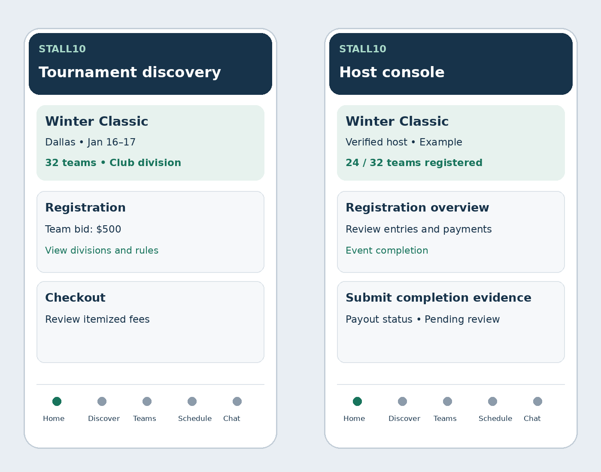

<!-- Converted from Stall10_Tournament_Marketplace_Blueprint_UI.docx; the Word original is kept alongside. Do not edit the requirements here without updating the source. -->

# Tournament marketplace

PRODUCT STRATEGY & TECHNICAL IMPLEMENTATION

Flutter mobile • Next.js web • Firebase • Shared backend API • Stripe Connect

### Executive decision

Make Stall10 the discovery and registration hub for independent and sanctioned ultimate tournaments. Anyone may submit a listing; only verified organizers with approved events may collect money. Hosts set their own bid fees and receive the agreed bid amount, subject to refunds, disputes and contractual adjustments.

### Launch scope

- Free public directory, external registration links, community submissions and duplicate reporting.
- Verified organizer onboarding, venue review, paid team registration, receipts and refund handling.
- Manual completion review and controlled host transfers. No instant payouts or automatic early releases at launch.
- Sport-agnostic event and division models; ultimate is the first supported sport.

### Success metrics

Track published events, registration conversion, completed tournaments, gross payment volume, net contribution, refund/dispute rate, approval turnaround and maximum unrecoverable exposure per host.

### Decisions and constraints

Assumes US-only, USD, adult organizers, Firebase Auth and Firestore, with a TypeScript API on Cloud Run as a suggested deployment (existing API may be reused). Stripe Connect is proposed, not yet approved for this business. Payout windows, pricing and liability must be confirmed before launch. This is a design specification, not deployed or tested code.

# 02  Marketplace and host policy

| Tier | Permissions and controls |
|---|---|
| Community | Submit listings; free events or external registration; moderation required. |
| Verified | Stripe onboarding complete; venue independently confirmed; paid events manually approved; capped exposure. |
| Trusted | Multiple independently verified completed events; low dispute rate; eligible for reviewed early releases later. |

### Event submission

Collect organizer, sport, division, dates/time zone, venue, field reservation evidence, capacity, bid fee, registration deadline, cancellation policy, sanctioning status and contact information. Separate third-party listing submissions from organizer-owned events; require a claim and review before enabling payments. Never imply USAU sanctioning without evidence.

### Approval and completion

Review venue evidence using independently sourced contact details. Require reapproval for material changes to dates, venue, price, ownership or payout destination. At completion, use independent captain confirmations, match results and reports; never rely only on the host. Freeze releases when complaints or conflicting evidence exist.

### Risk controls

- Require verified email, MFA for sensitive actions, Stripe identity and bank onboarding; bank verification is not proof of event legitimacy.
- Cap first-event gross volume and concurrent events; proposed pilot cap $5,000, adjustable after review.
- Review unusual payment velocity, related accounts, repeated cards, abrupt bank changes and mismatched locations. Use Radar and risk-based authentication.
- Avoid mandatory deposits initially; a $200 deposit cannot protect a $16,000 event. Consider contractual reserves only after processor/legal review.

# 03  System architecture

Flutter mobile       Next.js web / admin  
       \\                 /  
        HTTPS API + Firebase ID token  
                  |  
   Auth / Events / Registration / Payments / Risk  
        |              |              |  
   Firestore       Cloud Tasks      Stripe Connect  
   Storage         Scheduler        Webhooks -&gt; API

### Backend responsibilities

Reuse your existing API as the sole authority for financial writes. Verify Firebase ID tokens using Admin SDK; enforce resource ownership, team roles and admin permissions on every endpoint. Use Secret Manager for Stripe keys and webhook secrets. Use separate dev, staging and production Firebase/Stripe environments.

### Suggested module structure

src/  
  auth/          middleware, permissions  
  tournaments/   listing, approval, completion  
  hosts/         onboarding, trust, risk  
  registrations/ capacity, checkout, expiry  
  payments/      stripe, webhooks, refunds  
  ledger/        journals, reconciliation  
  payouts/       eligibility, transfer worker  
  admin/         review queues, audit  
  jobs/          retries, expiry, reconciliation

### Client boundaries

Flutter uses Firebase Auth and a Stripe PaymentSheet integration; Next.js uses Firebase Auth and Stripe Checkout or Payment Element. Both request server-generated payment sessions. Never embed secret keys or accept client-calculated prices. Public discovery may use read-only Firestore projections or the API. Store venue documents privately; do not collect raw identity or bank details.

### Infrastructure

Cloud Tasks for durable asynchronous operations; Cloud Scheduler for expiry, reconciliation and release eligibility. Use structured logs with correlation IDs, alerting and least-privilege service accounts. Avoid logging payment secrets or personal documents.

# 04  Firestore data model

| Collection | Key fields (illustrative) |
|---|---|
| hosts/{uid} | stripeAccountId, trustTier, onboardingStatus, riskStatus |
| tournaments/{id} | hostId, sport, venueId, startsAt, endsAt, status, policyVersion |
| divisions/{id} | eventId, capacity, reservedCount, paidCount, bidCents, currency |
| registrations/{id} | eventId, divisionId, teamId, payerUid, status, expiresAt, priceSnapshot |
| payments/{id} | registrationId, intentId, chargeId, grossCents, feeCents, status |
| ledgerEntries/{id} | journalId, account, debitCents, creditCents, currency, sourceId |
| transfers / payouts | hostId, eventId, amountCents, stripeId, status, operationId |
| refunds / disputes | paymentId, amountCents, reason, stripeId, status |
| reviews / riskFlags | eventId, actorId, evidenceRef, status, severity |
| webhookEvents / operations | providerEventId, operationKey, state, attempts, timestamps |
| auditLogs | actorId, action, targetId, before/after summary, timestamp |

### Data invariants

Use integer cents and explicit currency. Store immutable price and refund-policy snapshots. Enforce one active registration per team/division using a deterministic document key. Reserve capacity in a Firestore transaction; never call Stripe inside that transaction. Maintain private financial records and separate public listing projections.

### Indexes and access

Composite indexes: published status + start date; sport + region + start date; hostId + status; eventId + registration status; release status + eligibleAt. Deny direct client writes to payment, ledger, host trust, capacity and audit collections. Admin SDK bypasses rules, so API authorization is mandatory.

# 05  API contract

| Method / route | Purpose |
|---|---|
| POST /hosts/onboarding | Create/reuse connected account and onboarding link |
| GET /hosts/me | Return verification and payout eligibility |
| POST /tournaments | Create draft or community submission |
| POST /tournaments/:id/submit | Submit for moderation |
| GET /tournaments | Filter public events; cursor pagination |
| POST /divisions/:id/checkout | Reserve team spot; return payment session |
| GET /registrations/:id | Read authoritative registration status |
| POST /registrations/:id/refund | Request refund; validate policy and authority |
| POST /tournaments/:id/complete | Submit completion evidence |
| POST /admin/events/:id/approve | Approve event or completion with audit trail |
| POST /admin/releases/:id/approve | Authorize eligible transfer; enqueue job |
| POST /webhooks/stripe | Verify raw-body signature; persist event; enqueue processing |

### Request conventions

Authorization: Bearer &lt;Firebase ID token&gt;  
Idempotency-Key: &lt;unique client operation ID&gt;  
POST /divisions/div_123/checkout  
{ "teamId": "team_456" }  
Response: { "registrationId": "reg_789",  
  "clientSecret": "...", "expiresAt": "..." }

Return 401 for unauthenticated, 403 for unauthorized, 409 for capacity or state conflicts, 422 for invalid inputs. Bind idempotency keys to caller and request hash. Use pagination and rate limits. Web checkout can return a Checkout URL instead of a PaymentIntent client secret.

# 06  Payment implementation

### Stripe Connect setup

Use Stripe-hosted connected-account onboarding. Select a Connect configuration that supports your intended transfer and payout controls; confirm responsibility for negative balances. Track account capability and requirements updates via webhooks. Do not accept paid registrations until onboarding and event review are complete.

### Checkout sequence

- API verifies captain authority, event status, registration deadline and capacity. Compute bid and service fee from server-side policy.
- Firestore transaction creates a pending registration and reserves a slot. Persist an operation ID.
- Create a platform PaymentIntent (or Checkout Session) with registration metadata and a stable Stripe idempotency key. Persist provider IDs.
- Client confirms payment through Stripe UI. Show processing until the API confirms success.
- Webhook worker validates amount, currency and registration; atomically marks paid, converts reservation and writes balanced journal entries. Send receipt via an outbox job.
- Expiry worker cancels the payment/session before releasing capacity. If payment succeeds late, reconcile and refund or honor only if capacity remains.

### Illustrative pricing

| Item | Amount |
|---|---|
| Host bid | $500.00 |
| Combined service fee (5%) | $25.00 |
| Team pays | $525.00 |
| Estimated processing (2.9% + $0.30) | $15.53 |
| Contribution before other costs | $9.47 |

At 100 events × 32 teams, estimated contribution is $30,304 using per-transaction rounding. Excludes Connect fees, refunds, disputes, taxes and overhead. Rates are illustrative, not verified current pricing. Display the full payable price upfront and disclose refund terms.

# 07  Transfers, refunds and reconciliation

### Release policy

Use Separate Charges and Transfers if approved by Stripe. Platform charges and connected-account transfers are distinct from bank payouts. At launch, release only after verified completion and manual approval; consider a 90% release and 10% reserve for 30 days only if permitted by Stripe and counsel. Do not describe the arrangement as escrow. Confirm maximum permitted holding periods, especially for events booked months ahead.

### Transfer worker (pseudocode)

claim operation with durable unique release ID  
check event completed, approval valid, no risk hold  
check refundable exposure and available Stripe funds  
amount = approved entitlement - prior releases  
create Stripe transfer with stable idempotency key  
record transfer ID and balanced ledger journal  
reconcile ambiguous failures before retrying

### Refunds and disputes

Before transfer, refund against the original charge. After transfer, attempt a transfer reversal where supported and refund the original charge separately. A failed reversal does not remove the platform’s refund obligations. Freeze further releases when a dispute opens; gather evidence, meet processor deadlines and account for fees. Never refund to a different card or bank account.

### Ledger example (illustrative)

| Journal | Debit | Credit |
|---|---|---|
| Payment received | Processor clearing $525 | Host payable $500; fee revenue $25 |
| Processing fee | Expense $15.53 | Processor clearing $15.53 |
| Host transfer | Host payable $500 | Processor clearing $500 |

Use compensating entries for refunds, disputes and reversals; never overwrite posted entries. Reconcile daily against Stripe balance transactions, charges, transfers and payouts. Maintain platform liquidity for losses and refund fees; accountant to validate recognition and tax treatment.

# 08  Client and admin experience

### Flutter screens

Discover (filters, calendar, location), event detail, team selection, registration checkout, payment pending/confirmed, receipt, refund request, organizer onboarding, event creation, host dashboard and completion submission. Use deep links for onboarding returns; refresh verification from API rather than trusting return parameters.

### Next.js routes

/tournaments                 Public discovery  
/tournaments/[id]            Event detail  
/tournaments/[id]/register   Team checkout  
/host/events                 Organizer dashboard  
/host/events/[id]            Manage registrations  
/host/finances               Pending and released funds  
/admin/reviews               Host/event approval  
/admin/risk                  Flags and disputes  
/admin/releases              Transfer approval  
/admin/reconciliation        Financial exceptions

### Admin operations

Show verification status, evidence, registration volume, pending liabilities, refund requests, dispute deadlines and payout holds. Require MFA, role-specific permissions, reason codes and audit logs. Use two-person approval for exceptional or large releases where staffing allows; otherwise keep pilot limits low and document independent review.

### State machines

Event: draft → submitted → approved → published → in progress → completion review → completed. Alternate states: rejected, suspended, canceled. Registration: reserved → payment pending → paid → refunded/canceled; expiry and payment failure handled explicitly. Payment, dispute and transfer statuses remain separate.

Never display a host as trusted merely because their bank account is verified. Distinguish identity verified, event verified and established host badges.

# 09  Build sequence and launch gates

| Phase | Deliverable / acceptance gate |
|---|---|
| 1. Directory | Search, submit, moderate, claim, external links; duplicate reporting works. |
| 2. Onboarding | Stripe test accounts, capability sync, private evidence, manual approval. |
| 3. Registration | Capacity transactions, checkout, signed webhooks, receipts; no overselling. |
| 4. Financial ops | Ledger, refunds, disputes, reconciliation, manual transfer approvals. |
| 5. Pilot | Invite known directors; low volume limits; monitor and review every event. |
| 6. Scale | Trust tiers, risk scoring, approved early releases, multi-sport expansion. |

### Required test cases

- Two captains compete for last slot; duplicate checkout and duplicate/out-of-order webhooks.
- Payment succeeds after expiry; API crashes after Stripe call; worker retries after timeout.
- Host changes bank account, event venue or bid price; unauthorized captain/admin attempts.
- Full and partial refunds before/after transfer; failed reversal; dispute after event.
- Canceled event, suspicious completion, failed payout, ledger mismatch and insufficient platform funds.

### Production blockers

Confirm Stripe business approval, holding limits, Connect fees and liability. Obtain legal review of organizer agreements, cancellation/refund policies, marketplace payment regulation, tax reporting, insurance and consumer fee disclosures. Review mobile store rules for real-world event purchases. Establish incident response, support ownership and cash reserves before accepting live payments.

### Implementation references (verify current terms)

Stripe: docs.stripe.com/connect/separate-charges-and-transfers • docs.stripe.com/connect/hosted-onboarding • docs.stripe.com/webhooks • docs.stripe.com/radar  
Firebase: firebase.google.com/docs/auth/admin/verify-id-tokens • firebase.google.com/docs/firestore/manage-data/transactions • firebase.google.com/docs/firestore/security/get-started

# Design appendix / Competition marketplace

Concepts for discussion • Not current application screenshots. Fictional example data. Existing requirements remain unchanged.

Option A (left): Tournament discovery — recommended starting point. Option B (right): Host console — complementary or alternate emphasis. Both use the same navigation and visual language.

Responsive implementation: on mobile, stack cards and retain bottom navigation; on desktop, use a persistent navigation rail and place secondary cards alongside the primary content. Respect role and audience permissions; provide loading, empty, error and inaccessible states. Use accessible contrast, scalable text and keyboard navigation.
